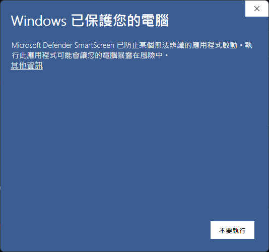
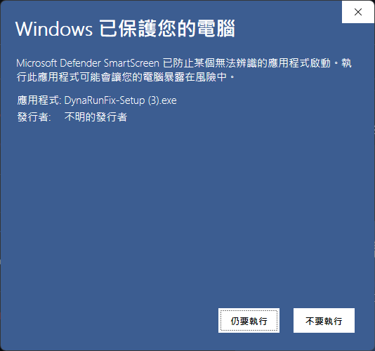
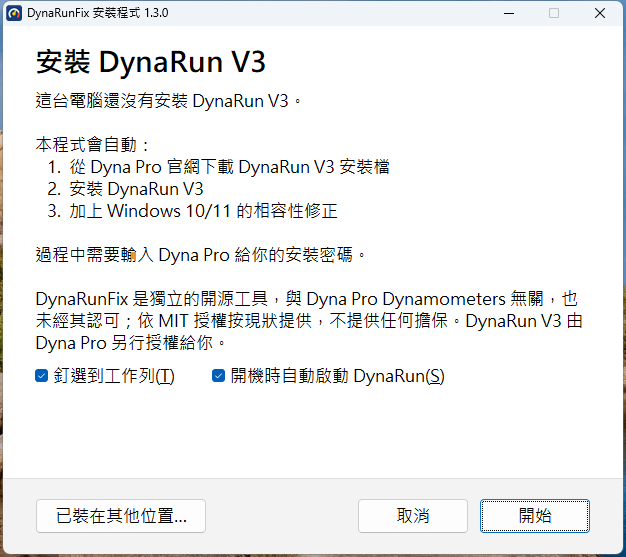
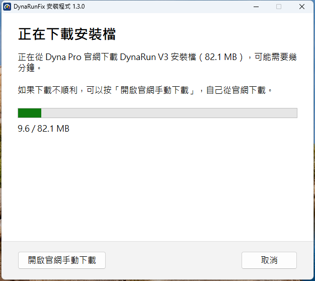
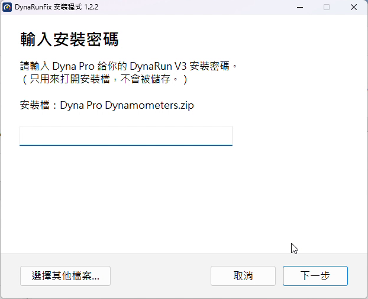
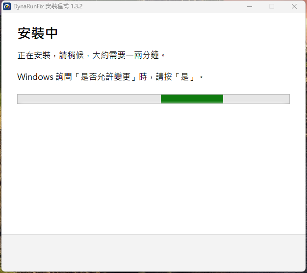
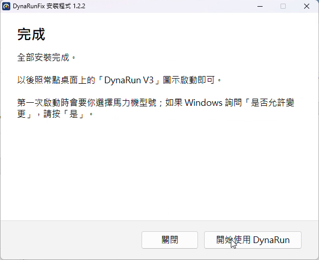

# DynaRunFix

[](https://github.com/timliudev/DynaRunFix/actions/workflows/build.yml)

A small compatibility shim that stops the **main-screen flicker** of the *DynaRun V3* dynamometer
software (Dyna Pro Dynamometers, S68 and similar rigs) when it runs **natively on Windows 10 / 11**.

[繁體中文說明在下方](#繁體中文)

> This project is not affiliated with or endorsed by Dyna Pro Dynamometers Ltd. *THBResize* (`THBRes25.dll`),
> the resize control DynaRun uses, is a product of THB Componentware; DynaRunFix is not affiliated with THB
> Componentware either. DynaRunFix does not contain or redistribute any of their files, it modifies no Dyna Pro or
> THB file on disk, and it does not bypass, disable or alter DynaRun's licence activation or copy protection.
>
> To be plain about what it does change: DynaRunFix **changes DynaRun's behaviour while it runs**, in memory, inside
> the DynaRun process only. No Dyna Pro or THB file is modified. In detail, it
>
> - redirects import-table entries of modules loaded in that process: `PostMessageA` in `THBRes25.dll`; the
>   file-attribute APIs, `GetProcAddress` and the text APIs imported by Microsoft's `MSVBVM60.DLL` and `scrrun.dll`; the font
>   APIs in `DynaRun V3.exe`, the other modules in DynaRun's folder and its OCX controls; the font-related imports of
>   `THBRes25.dll`, `PEGRP32E.dll`, `MSVBVM60.DLL`, `ole32`, `oleaut32`, `MFC42`, `comctl32` and `dynapro.dll` (delay-load imports
>   included); `CreateFileA` in `dynapro.dll` (to observe the device open; results are passed on unchanged) and, only with the
>   opt-in USB switch, `WaitForSingleObject` in `dynapro.dll`; and `LoadLibraryExA` / `LoadLibraryExW` in the graph control's own modules `Pesgo32e.ocx` and
>   `PEGRP32E.dll` (Gigasoft ProEssentials), only for the request for its language resource `PEGRC32D.dll`, see
>   [Graph menu in the wrong language](#graph-popup-menu-stays-english-without-administrator-rights);
> - replaces the results of DynaRun's `GetProcAddress` lookups of `ShellExecuteA` and `DPConnect` with its own wrappers, and,
>   only with the opt-in USB switch, of `DPSetData`;
> - subclasses DynaRun's main form (`WM_WINDOWPOSCHANGING`, `WM_GETMINMAXINFO`, and it sends `WM_SETFONT` again), installs two
>   window-message hooks on DynaRun's GUI thread (`WH_CALLWNDPROC`, `WH_CALLWNDPROCRET`) and stores a few window properties
>   (`SetProp`, for example the previous `WM_SIZE`) on DynaRun's own windows;
> - adjusts the VB6 runtime's in-memory screen size values (see [Status bar hidden behind the taskbar](#status-bar-hidden-behind-the-taskbar));
> - **writes DynaRun's own settings** under `HKCU\Software\DynaPro` (`Default_Language` and `System_Setup`: the user's own
>   choices on the first start, see [First-time setup](#first-time-setup)), and `%TEMP%\dynafix.log`.
>
> The installer points DynaRun's shortcuts at the launcher (the original shortcut files are backed up) and, only when
> Windows' UTF-8 option is on, adds a manifest file next to `DynaRun V3.exe` (see [Usage](#usage)). DynaRunFix never runs
> DynaRun with more rights than a normal start from your desktop (with UAC off, that normal start is already full administrator), or does not start it (see [Usage](#usage)). DynaRunFix does not touch any licensing,
> activation or copy-protection mechanism or component.
>
> You need your own legally installed copy of DynaRun V3, and it is up to you to make sure that using this
> fix is consistent with your licence agreement with Dyna Pro. DynaRun V3 is licensed to you by Dyna Pro
> under their own terms; the MIT licence of this project covers only DynaRunFix.

## Symptom

On Windows 10/11 the DynaRun V3 main dashboard flashes continuously (the whole window disappears and
reappears several times per second). The same installation is stable on Windows XP and Windows 7.
DPI settings, compatibility modes and whether the USB dyno is connected make no difference.

## Cause (as observed)

DynaRun V3 is a Visual Basic 6 application; its forms are scaled by the third-party *THBResize 2.5* control
(`THBRes25.dll`). Logging the window messages of DynaRun's main form from outside shows:

1. After each `WM_SIZE` of the form, a private message `0x591` is posted to it.
2. Each `0x591` is followed by the same sequence of windows: the main form is hidden, a blank form appears,
   the main form is shown maximized again and the blank form is closed.
3. On **Windows 7/XP** showing the hidden, already-maximized form again produces no `WM_SIZE` when its size is
   unchanged, so the sequence runs once and stops.
4. On **Windows 10/11** the same step produces another `WM_SIZE (SIZE_MAXIMIZED)` with the unchanged size (the
   window-position change carries the "state changed" flag), which is followed by another `0x591` → a repeating
   hide/show loop.

Message logs and the comparison between Windows versions: [docs/ROOT_CAUSE.md](docs/ROOT_CAUSE.md).

## The fix

`dynafix.dll` is loaded into the running DynaRun process by the `DynaRunFix.exe` launcher. Inside that
process only, it redirects THBRes25.dll's import of `PostMessageA` and drops the `0x591` message when it
was triggered by a `WM_SIZE` that is identical to the previous one for the same form. That restores the
Windows 7 behaviour; genuine size changes still go through. No file is changed; the dll writes a
small log, `%TEMP%\dynafix.log` (every line starts with the date and time; a line is at most 1000 characters, longer ones end in `...`;
when the dll or the launcher starts and the file is above 10 MB, it is cut to its newest 8 MB, from a full line on; it is not trimmed
while DynaRun runs, so within one session it can grow beyond 10 MB; the launcher and the dll write to it in turn, so their lines are interleaved in time order) and,
on the very first start only, DynaRun's own language and feature settings into DynaRun's registry key `HKCU\Software\DynaPro` (see below). The log names modules and APIs but no memory
addresses, and can contain file paths and window titles: look through it before you post it anywhere. The same dll also fixes the [first-time setup](#first-time-setup) and
[OneDrive files that will not open](#some-dpr-files-will-not-open-empty-file-run-properties-no-curves).

## What's new

v1.4.0 (2026-10-14):
- DynaRunFix never runs DynaRun with more rights than a normal start from the desktop: a launcher that is run as administrator
  starts itself again with the desktop shell's token (non-elevated under UAC; if the desktop itself is already full administrator,
  that is what a double-click gives too and it is used), or refuses to start DynaRun when no such token can be had. The installer
  no longer copies COM registrations to the machine-wide registry; shortcuts no longer carry the *Run as administrator* flag.
- The graph control's right-click menu is in the chosen language without administrator rights (see
  [Graph menu in the wrong language](#graph-popup-menu-stays-english-without-administrator-rights)).
- Installer, update and download hardening; uninstall asks for administrator permission first and for DynaRun to be closed.
- First start: when the option buttons of DynaRun's system selection cannot be read reliably, nothing is written (only logged).
- The log no longer contains memory addresses, and neither the launcher nor the dll follows links (symbolic links, junctions) when writing it.
- Experimental, off by default, not yet verified with real hardware: `DYNAFIX_USBFIX` for a USB device that stops answering.

v1.3.6:
- Connection diagnostics: log lines and a small non-blocking hint when the Dyna Pro cannot be reached or is in use by
  another program (see [DynaRun says nothing when it cannot reach the Dyna Pro](#dynarun-says-nothing-when-it-cannot-reach-the-dyna-pro);
  `DYNAFIX_CONNHINT=0` turns the hints off).
- The update question no longer keeps DynaRun from starting: DynaRun always opens first, a newer release is offered
  beside it at most once a day.
- An OCX that DynaRun unloads and loads again keeps the Windows UI font.
- More robust start-up next to other tools that patch the same imports (loggers, compatibility shims); safer
  launcher command line, elevated restart and log writing.

v1.3.5:
- The run viewer that opens after a run ("Dyna Pro測試後看圖程式") fills the screen above the taskbar when
  maximized (before, it was about 76 px too narrow and the desktop showed on the right).

v1.3.4:
- The installer no longer picks up other programs' zips from *Downloads* (e.g. a tuning tool's zip with an MSI
  inside) and then says "This is not the DynaRun V3 setup".

v1.3.3 / v1.3.2:
- The running DynaRun groups under the pinned DynaRun icon and shows DynaRun's own blue logo on the taskbar (not
  the chart icon as an extra button), also after updating from an older version.

v1.3.0:
- The installer can pin DynaRun to the taskbar and start it at sign-in (both on by default).
- Updates: once a day DynaRunFix looks for a newer release and installs it on one click.
- The first start right after installing shows the main screen correctly (before, it could be laid out too big
  until DynaRun was started again).
- Every log line has the date and time.
- After changing the screen resolution with DynaRun open, restart DynaRun (DynaRun's own behaviour, see
  [DynaRun's screen looks wrong](#dynaruns-screen-looks-wrong)).

v1.2.3:
- Nothing that changes Dyna Pro's setup is shipped any more (`tools/msi-novbs` removed).
- The installer and the zip include miniz's licence (`LICENSE-miniz.txt`).

v1.2.2:
- First start keeps the chosen language and optional features.
- DynaRun's text in Windows' own UI font; Chinese everywhere on Windows installed in English with a Chinese locale.
- The taskbar no longer hides DynaRun's status bar.
- Installer: closes a running DynaRun for you, stays in front, works from a network drive, has an icon.

All versions: [CHANGELOG.md](CHANGELOG.md).

## Usage

1. Download **`DynaRunFix-Setup.exe`** from [Releases](https://github.com/timliudev/DynaRunFix/releases)
   and double-click it. Windows SmartScreen may say *"Windows protected your PC"* because the file is not
   code-signed: click **More info → Run anyway**.

   | 1. Click *More info* | 2. Click *Run anyway* |
   |---|---|
   |  |  |

2. Follow the window. If DynaRun V3 is not installed yet, it downloads the DynaRun V3 setup from
   [Dyna Pro's website](https://dynapro.co.uk/Software_Release.htm) (or uses a
   DynaRun setup zip or `Setup.msi` already in *Downloads*, on the desktop, in *Documents* or next to the
   installer), asks for the **setup password you got
   from Dyna Pro**, shows Dyna Pro's license (read from the setup and shown by DynaRunFix itself) and installs DynaRun V3 and the fix only after you accept it (if the
   license cannot be read from the setup, you must confirm that you accept Dyna Pro's license terms instead).
   If DynaRun V3 is already installed, it only installs the fix. Windows asks once for permission: click **Yes**.
3. Start DynaRun with its usual **DynaRun V3** icon. On the very first start (system selection) Windows asks
   once more for permission for Dyna Pro's configuration helper: click **Yes**; DynaRun then restarts by itself.

| | | |
|---|---|---|
|  |  |  |
| 4. Dyna Pro license page (shown by DynaRunFix itself, with the license text read from the setup; not reproduced here) |  |  |

*Fresh Windows 11 (Traditional Chinese), DynaRunFix 1.3.2.*

Nothing of Dyna Pro's is included in DynaRunFix: the setup comes from Dyna Pro's site and the password from
Dyna Pro. The DynaRun setup runs with basic UI (`msiexec /qb!`), so Dyna Pro's own wizard pages, including its license page, are skipped (DynaRunFix shows the license itself). The password is used only to open the zip and is not stored. Before the elevated install, the setup is copied to a folder
that only administrators can write to and checked again there; DynaRun is installed from that copy.
The setup is recognised by its content, not its file name: only an MSI that identifies itself as DynaRun V3 (upgrade code and product name) is ever installed; for the zip this is
checked after the password has opened it. When looking in *Downloads* and the other folders by itself, the
installer only takes a DynaRun MSI or a password-protected zip with an MSI inside (Dyna Pro's zip has a password);
a file it found there that turns out not to be DynaRun's is skipped without a message and the next one, or the
download, is used. Another zip can still be chosen with *Choose file...*; a file you chose that is not the DynaRun
setup is refused with a clear message.

What the installer does for the fix:
- installs `DynaRunFix.exe`, `dynafix.dll`, `LICENSE.txt`, `LICENSE-miniz.txt`, the licence files `le\COPYING`, `le\COPYING.LESSER`
  and `le\THIRD-PARTY.txt` (see [Third-party licences](#third-party-licences)) and a copy of `DynaRunFix-Setup.exe` (the
  uninstaller) to `Program Files (x86)\DynaRunFix` on 64-bit Windows (`Program Files\DynaRunFix` on 32-bit Windows);
- points the existing DynaRun V3 shortcuts (desktop, Start menu, pinned taskbar, all users and current
  user) to the launcher, keeping their name and icon (the *Run as administrator* flag is not carried over: DynaRun is never started with more rights
  than a normal start from your desktop (with UAC off, that normal start is already full administrator); the original shortcut files are backed up); creates a desktop
  shortcut if there is none. Shortcuts of ours get DynaRun's blue logo (from the icon file of Dyna Pro's own
  shortcuts; `DynaRun V3.exe` itself only has the chart icon of its windows), so the running DynaRun shows that logo
  on the taskbar;
- only if Windows' *UTF-8 for worldwide language support* option is on: adds the
  [code-page manifest](#garbled-chinese-or-other-dbcs-text-with-windows-utf-8-option) next to `DynaRun V3.exe` (the exe's
  modification time is briefly changed and restored so that Windows reads the manifest, and the installer briefly creates the
  `DynaRun V3.exe` process suspended and terminates it at once so that Windows reads the manifest; no DynaRun code runs and the exe's content is not changed).
  Not done when DynaRun's folder or exe can be changed by ordinary users, or when its path is not a plain local one: then no manifest is written and DynaRun's path is not recorded
  in the machine-wide registry for the elevated steps (uninstall) to use; `setup.log` in the install folder says so. On Windows XP links (junctions) in that path cannot be detected, only the permission checks apply;
- puts [Locale Emulator](#garbled-chinese-or-other-dbcs-text-with-windows-utf-8-option) in `DynaRunFix\le`
  (used only on a Traditional Chinese system with the UTF-8 option on, or whose FontAssoc lacks `ANSI(00)=YES`);
- registers an uninstaller in *Programs and Features* / *Installed apps*.

Uninstalling restores the original shortcut files and removes the manifest it added only if the file is identical to the installer's own copy (a manifest that differs is left alone); if
restoring the exe's modification time fails, the record of the original time is kept and the restore is tried again at the next run; the uninstall runs from the installed program (the install folder is administrators-only; no copy is made in `%TEMP%`), and the install folder with its setup file is removed by Windows at the next restart if it is still in use; other accounts'
shortcuts that still start the fix are pointed back at `DynaRun V3.exe`. It asks whether to remove the fix only or
DynaRun V3 too (*Remove all* then runs Dyna Pro's own uninstaller of DynaRun V3). It asks for administrator permission first;
if you cancel that prompt, nothing is changed. If DynaRun is running, it asks to close it first. Older versions copied DynaRun's COM
registrations to the machine-wide registry; uninstalling keeps those copies and their records (`com-copied.txt`, `com-backup`
in the install folder). DynaRun's exe and program content stay unchanged (the original shortcut files are backed up and restored; the only file added is the manifest, and only with the UTF-8 option on), and your data files are never changed. Windows XP, 7, 10 and 11 are supported; options: `/quiet`,
`/uninstall`, `/notaskbar`, `/noautostart`, `/keep`. `/quiet` installs only the fix and needs DynaRun V3 installed (exit
code 1 if it is not found).

Two options on the first page of the wizard, both on by default (`/quiet` applies both unless switched off with
`/notaskbar` / `/noautostart`):
- **Pin DynaRun to the taskbar.** Windows 7 to 10 pin the launcher shortcut directly; Windows XP / Vista add it to
  Quick Launch. Windows 11 lets no program pin itself, so the installer uses Microsoft's
  [taskbar layout policy](https://learn.microsoft.com/windows/configuration/taskbar/pinned-apps) for the user
  (`TaskbarLayout.xml` in the install folder; `StartLayoutFile` / `LockedStartLayout` under
  `HKEY_USERS\<user>\Software\Policies\Microsoft\Windows\Explorer`, set by the administrator step): the icon
  appears after the next sign-out / sign-in. If an organization has already set a layout file it is left alone,
  and the last page tells how to pin by hand (right-click the desktop icon → *Show more options* → *Pin to taskbar*).
  A running DynaRun groups under the pinned icon (the launcher shortcuts and DynaRun share an AppUserModelID). The pinning
  technique for Windows 7 to 10 is the one described by Gee Law ([blog post](https://geelaw.blog/entries/msedge-pins/)); Firefox uses the same approach; no Mozilla code is included.
- **Start DynaRun when Windows starts:** the value `DynaRunFix` under `HKCU\Software\Microsoft\Windows\CurrentVersion\Run`
  starts the launcher (`DynaRunFix.exe /autostart`) at sign-in. Installing again with the box cleared removes it; uninstall removes the Run value for every account, the taskbar policy values of the account that installed them, and points the pinned
  launcher shortcuts back at `DynaRun V3.exe`.

**Updates.** DynaRun always opens first; the update never delays it. Once a day, after DynaRun was started, the
installed setup asks GitHub's API for the latest release of this repository (nothing else is sent) in the background.
The check talks HTTPS only, and only to GitHub's own hosts (the API, `github.com` and GitHub's release-asset hosts; every
redirect is checked, for the check as well as for the download). When a newer one is known, the next start of DynaRun shows (beside the running DynaRun, at most once a day)
*Yes* (install it after you close DynaRun), *No* (skip this version; a newer release is offered again) or *Cancel* / the window's
close button (ask again tomorrow). *Yes* downloads that release's `DynaRunFix-Setup.exe` (from `github.com/timliudev/DynaRunFix`; a redirect may only go to GitHub's own hosts: `github.com`, `api.github.com`, `objects.githubusercontent.com`, `release-assets.githubusercontent.com`),
checks its SHA-256 against the one GitHub lists (the release is checked again just before the install, and the downloaded file is held open so it cannot be swapped) and installs it with `/quiet /keep` (one administrator prompt; `/keep`
leaves the pin, the start at sign-in and the desktop shortcut as they are) once DynaRun is closed. No update question
is ever asked for `/autostart`, `/restart`, `/noupdate`, or when `DYNAFIX_NOUPDATE=1` is set, and not when the
launcher only attaches to a DynaRun that is already running. Every start of the setup by the launcher is written to
`%TEMP%\dynafix.log` first, with its arguments and the reason. Without internet, on Windows XP / Vista (no TLS 1.2), or on Windows 7 without update KB3140245 (TLS 1.2 support; the check asks
for TLS 1.2 or later, like the downloads), nothing happens.

DynaRun must be closed while the fix is installed or updated: a running DynaRun keeps the old
`dynafix.dll` (and Locale Emulator's dlls) loaded. The installer checks for a running `DynaRun V3.exe`
(and for `DynaRunFix.exe` / `LEProc.exe` from its own folder) before it changes anything. The wizard
then offers *Close DynaRun and install*: DynaRun is closed like with its own close button, and ended
if it is still running 10 seconds later (a test run in progress stops, unsaved data is lost).
`/quiet` changes nothing and ends with exit code **6**; `/quiet /close` closes DynaRun the same way first.
After copying, each installed file is read back and compared with the installer's copy.

If *Documents* is in OneDrive and an earlier copy of DynaRun's manuals or example files there is
"online-only", the installer reads those files first so that OneDrive downloads them; Windows Installer
cannot do that itself and would stop with error 1305. File contents and OneDrive settings are not changed.

**DynaRunFix never runs DynaRun with more rights than a normal start from the desktop**, and DynaRun does not need administrator
rights. The launcher ignores the compatibility setting *Run as administrator* for `DynaRun V3.exe`; if the launcher itself is run as
administrator, it first starts itself again with the token of the desktop shell (Explorer) and ends, so DynaRun (and Locale Emulator)
get exactly what a double-click on the desktop would give them: the user's normal, non-elevated token under UAC. If the shell's token
is itself elevated (User Account Control off, or the built-in Administrator: the normal desktop is already full administrator), the
launcher carries on with it and writes that to `dynafix.log`; there is nothing to drop, and `dynafix.dll` then skips the graph
language redirect (see below). Only if no shell token can be had at all does the launcher show a message and not start DynaRun. When
the token was non-elevated, or the compatibility setting was ignored, a one-time notice is shown
(English or Traditional Chinese; answer *No* to *Show this notice again next time?* to switch it off). If a DynaRun that
is already running was started with more rights than the launcher has, the launcher asks you to close it and start it again through DynaRunFix.
The compatibility variable `__COMPAT_LAYER=RunAsInvoker` that the launcher sets for DynaRun is removed again by `dynafix.dll` inside DynaRun's
process, so that Dyna Pro's configuration helper, which DynaRun starts on the first start, still asks for permission as it normally does.
Do not run `DynaRun V3.exe` itself as administrator, see [below](#run-as-administrator-is-not-needed).

### Manual use (zip)

The zip on the Releases page contains the same files (plus `le\`, the manifest and `LICENSE-miniz.txt`) for manual use: keep `DynaRunFix.exe` and
`dynafix.dll` **in the same folder** and start DynaRun through `DynaRunFix.exe`
(`DynaRunFix.exe "D:\path\to\DynaRun V3.exe"` for another location). If DynaRun is already running, the
launcher attaches the fix to it.

Check `%TEMP%\dynafix.log`: it should contain `patched THBRes25.dll import of PostMessageA`.

### What DynaRunFix verifies, and what it does not

- **The DynaRun V3 setup (Dyna Pro's file):** DynaRunFix downloads it only over HTTPS from `dynapro.co.uk` (the connection is
  refused if the certificate is invalid; HTTPS and `dynapro.co.uk` are checked again on every redirect hop, so a redirect away from
  `dynapro.co.uk` or to plain HTTP is refused), with TLS 1.2 or later (Windows 7 needs update KB3140245 for that) and a cap of 300 MB,
  and before installing it
  checks that the file identifies itself as the DynaRun V3 setup (Windows Installer upgrade code and product name). Dyna Pro
  does not sign its setup and does not publish checksums, so **DynaRunFix cannot prove that the file is exactly what Dyna Pro
  released**. Use only files you got from Dyna Pro's official site. On the license page the installer shows the file's full
  path, size, SHA-256 and the MSI's version and manufacturer, so you can compare them with whatever Dyna Pro gives you; it does
  not block anything based on them.
- **DynaRunFix's own updates:** the installer is checked against the SHA-256 that GitHub lists for the release file. Each
  release's notes include `SHA256SUMS.txt` (also attached to the release), and the release files carry a build provenance
  attestation (which repository and workflow built them). To check a downloaded file yourself:
  `gh attestation verify DynaRunFix-Setup.exe --repo timliudev/DynaRunFix`. This shows where a file was built, not that it is safe;
  the installer is not code-signed (see the SmartScreen note above).

## First-time setup

On its first start DynaRun asks for the language, then for the dyno model and optional features
("Dyna Pro系統選擇"). After **OK** Windows asks once for permission for `Setup_<nnn>.exe`, Dyna Pro's per-model
configuration helper: click **Yes**. DynaRun then restarts by itself with the chosen model, language and optional
features (climate monitor, water cooler, cooling fans, AFR analyser).

Without the fix DynaRun 3.26.0 hangs at this point on every Windows version, XP included: after the helper has
run, the selection window stays and one CPU core runs at 100 %. After a forced restart the language is English
and the optional features are off (the helper leaves the language value in the registry as `English` and the features' enable flags as `0`). `dynafix.dll` wraps DynaRun's `ShellExecuteA` call in memory:
it waits for the helper, puts the chosen language back, switches on the picked features with the same values
*Engineering mode → System configuration → Save and exit* writes, and restarts DynaRun through
`DynaRunFix.exe /restart <pid>`. Each step is logged to `%TEMP%\dynafix.log` (the log never contains memory addresses, and a symbolic link or junction in its place is not followed; every line starts with the date and time; a line is at most 1000 characters, longer ones end in `...`). `dynafix.dll` and the launcher can write to it at the same time: they take turns through a named lock (`Local\DynaRunFix.dynafix.log`), so lines are never mixed up, but their lines are interleaved. The size is checked only when the dll or the launcher starts: above 10 MB the file is cut to its newest 8 MB, from a full line on.

Screenshots of DynaRun's own windows are not included. What you see: first DynaRun's language selection
(English or Traditional Chinese), then its system selection screen (the machine model and the optional
modules, here climate monitor and AFR analyser picked), and after the automatic restart the main window in
the chosen language.

The `System_Setup` values written for the optional features are exactly the user's own choices on DynaRun's first-start
system selection screen. Observed with Process Monitor (registry operations only, on a fresh DynaRun 3.26.0 first start): the enable flags written are the same values, of the same type
(`-1` as text), that DynaRun's own *Save and exit* writes for the same selection. DynaRun itself additionally adjusts a few AFR display settings when it saves,
which DynaRunFix does not touch (they stay at their defaults until the configuration dialog is saved once). Nothing is written beyond what the screen
lets the user pick. If `dynafix.dll` cannot read the option buttons reliably (for example because of an unusual theme, scaling or
high-contrast setting), it writes no feature values at all and only logs this (only buttons that are clearly read as green, i.e. picked, are written; with any doubt, nothing is); the features can then be switched on in DynaRun's
*Engineering mode → System configuration*.

Root causes, registry values and test status: [docs/FIRST_START.md](docs/FIRST_START.md).

## Other Windows 10/11 problems

### "Run as administrator" is not needed

DynaRun does not need administrator rights for any of its screens, so the launcher starts it exactly as a normal start from the desktop would (not elevated on a normal UAC desktop; with UAC off or on the built-in Administrator the desktop itself is elevated and so is DynaRun, never more) and ignores the
compatibility setting *Run as administrator*. Do not run `DynaRun V3.exe` itself as administrator either: DynaRun's setup registers
several ActiveX controls (MSComm, MSCOMCTL, MSHFlexGrid, ...) only for the current user (`HKCU\Software\Classes`), elevated processes
ignore per-user COM registrations (Windows' rule), so an elevated DynaRun can stall at startup ("System Initializing. Please
Wait. 115") and alter its per-user component registrations. Start DynaRun through the DynaRunFix shortcut instead.

### Garbled Chinese text with a Traditional Chinese system locale

When Windows was installed in English and the system locale changed to Chinese (Taiwan) later, the
`HKLM\SYSTEM\CurrentControlSet\Control\FontAssoc\Associated Charset` key may lack `ANSI(00)=YES`. GDI
then draws DynaRun's Big5 labels in ANSI-charset fonts with code page 1252, which shows Latin letters
(`Aw³ï¥B·P...`). For a Traditional Chinese locale the launcher detects this and starts DynaRun through
[Locale Emulator](#garbled-chinese-or-other-dbcs-text-with-windows-utf-8-option) (with `dynafix.dll` attached as usual):
LE gives DynaRun the Big5 code page and charset in every window, including tooltips and OCX controls.
For other DBCS locales (and if LE is missing) `dynafix.dll` creates DynaRun's ANSI-charset fonts with the
locale's charset instead (`DYNAFIX_CHARSET`). Nothing in the registry is changed.
If the system locale is not Chinese at all, DynaRun's Chinese cannot be shown: set *Language for non-Unicode
programs* to Chinese (Traditional, Taiwan); the Chinese installer says so on its last page when it detects it.

### Garbled Chinese (or other DBCS) text with Windows' UTF-8 option

With *Region → Administrative → Change system locale → "Beta: Use Unicode UTF-8 for worldwide language
support"* enabled, the system ANSI code page is 65001 and VB6 programs show garbled DBCS text.

Copy [`manifest/DynaRun V3.exe.manifest`](manifest/DynaRun%20V3.exe.manifest) next to `DynaRun V3.exe`
(administrator rights needed in Program Files). It sets `activeCodePage=Legacy`, so DynaRun uses the system
locale's legacy code page (950 for zh-TW) while the rest of the system stays UTF-8. Windows caches the
"no manifest" result per executable, so after copying the file update the exe's modification time once
(elevated PowerShell; it is the change of the modification time that matters, not the new value):

```
(Get-Item 'C:\Program Files (x86)\Dyna Pro Dynamometers\DynaRun V3.exe').LastWriteTime = Get-Date
```

`DynaRunFix-Setup.exe` does this for you, puts the exe's modification time back afterwards, and briefly creates the `DynaRun V3.exe` process suspended
and terminates it so that Windows reads the manifest (no DynaRun code runs).

`%TEMP%\dynafix.log` then shows `ansi-codepage=950`. This fixes text converted inside the process (menus,
text boxes, message boxes, charts). Labels, graphic buttons and some captions are drawn through Windows
with the system code page and stay garbled; for those, DynaRunFix runs DynaRun through
[Locale Emulator](https://github.com/xupefei/Locale-Emulator) (LGPL-3.0):

- Put LE in a `le` folder next to `DynaRunFix.exe` (`DynaRunFix-Setup.exe` and the release zip already do; to fetch it yourself run
  `tools\fetch-le.ps1 -OutDir <folder>\le`). It is not installed: no context menu, nothing in the GAC.
  `le\LEConfig.xml` holds DynaRunFix's zh-TW profile.
- When the system code page is UTF-8, the system locale is Traditional Chinese (legacy code page 950) and
  `le\LEProc.exe` exists, `DynaRunFix.exe` starts DynaRun through LE and attaches the flicker fix right
  away. It does the same for a Traditional Chinese locale whose FontAssoc lacks `ANSI(00)=YES`
  ([above](#garbled-chinese-text-with-a-traditional-chinese-system-locale)). Otherwise it starts DynaRun
  directly, as before.
- Keep the manifest as well: only the combination shows all text correctly (manifest alone: labels
  garbled; LE alone: menus and message boxes garbled).
- Under LE fonts are created with the Big5 charset, so Windows would draw Arial and similar faces with
  MingLiU; `dynafix.dll` draws them in Microsoft JhengHei UI instead (see [Fonts](#fonts-windows-ui-font-everywhere)).

Verified on Windows 11 (UTF-8 option on) with DynaRun 3.26.0: menus, dialogs, labels, buttons, the
viewer and files in folders with Chinese names all work. Switching the UTF-8 option off also fixes
everything without LE. On systems without the UTF-8 option none of this is needed. `DynaRunFix-Setup.exe` adds the manifest
(and removes it on uninstall) only when the option is on.

### Fonts: Windows' UI font everywhere

DynaRun's forms ask for Arial, MS Sans Serif, Times New Roman or MingLiU (新細明體), and Windows substitutes
others for some of them, so one window mixed several faces. `dynafix.dll` now draws DynaRun's text in the
face Windows itself uses for dialogs in that language, picked by the code page DynaRun runs with (under Locale
Emulator that is Big5):

| Code page | Face (first one installed) |
|---|---|
| 950 Traditional Chinese | Microsoft JhengHei UI, Microsoft JhengHei |
| 936 Simplified Chinese | Microsoft YaHei UI, Microsoft YaHei |
| 932 Japanese | Yu Gothic UI, Meiryo UI |
| 949 Korean | Malgun Gothic |
| other (English, ...) | the system's message font: Segoe UI (Tahoma on XP) |

- Applies on every path: native Traditional Chinese Windows, a locale changed later (Locale Emulator or
  `DYNAFIX_CHARSET`), English Windows.
- Swapped faces: Arial, Times New Roman, MS Sans Serif, Microsoft Sans Serif, MS Shell Dlg, Tahoma, Verdana,
  Segoe UI, MingLiU / PMingLiU / 新細明體 and the other languages' old UI faces (SimSun, MS UI Gothic, Gulim, ...).
  Symbol, digital and fixed-pitch faces (Wingdings, 7-segment fonts, Courier New, ...) and narrow or heavy faces
  (Arial Narrow, Arial Black) stay as they are.
- Covers DynaRun itself, its OCX controls (toolbars, lists, grids, tabs, the chart), VB's fonts, THBResize and
  the common controls (tooltips), including the stock GUI font. Menus, message boxes and the file dialogs are
  drawn by Windows and already use the UI font.
- The UI faces have a taller line than the old ones, so text of 16 px and up is scaled to 90 % to keep
  multi-line labels fitting (`DYNAFIX_FONT_SCALE`, 50-150). VB is also told the line height of Arial
  (1.12 em) for the UI face, so lines of multi-line labels stay as close together as before; the text keeps
  its size (`DYNAFIX_FONT_LINEH`, in 1/1000 em, `0` = off).
- `DYNAFIX_FONT=<face>` picks another face, `DYNAFIX_FONT=off` (or `none`, `0`) keeps DynaRun's own fonts. Only DynaRun's
  process is affected; no file or setting is changed.

- DynaRun loads and unloads OCX controls while it runs. `dynafix.dll` follows the loader's notifications, forgets a module
  when it is unloaded and redirects its fonts again when it is loaded again (log lines `module tracking: ...`).
Status: verified on Windows 11 with DynaRun 3.26.0 (native Traditional Chinese, and English Windows with the
locale changed to Traditional Chinese through Locale Emulator).

### Graph popup menu stays English without administrator rights

The graph control (Gigasoft ProEssentials, `Pesgo32e.ocx` on `PEGRP32E.dll`) shows its right-click menu in the language of a
resource file `PEGRC32D.dll`, which it asks for by name when it loads. DynaRun's installer puts the copy for the chosen language in
`%APPDATA%\Dyna Pro Dynamometers\Dyna Run V3\Language\<language>\`, and at every start DynaRun tries to copy it into the Windows
system folder (`SysWOW64`). That is refused without administrator rights, so the menu stayed English.

`dynafix.dll` answers the control's request with the per-user file instead; nothing is written to the system folder.

- Only for the one file name `PEGRC32D.dll` (bare, or with the system folder's path). The redirected load is always a resource-only
  load: whatever flags the control passed, `dynafix.dll` loads the per-user file with `LOAD_LIBRARY_AS_IMAGE_RESOURCE` only, so the
  file is never run as code.
- The path is built by `dynafix.dll` from the profile folder and `HKCU\Software\DynaPro\Operation_Data\Default_Language`
  (a plain folder name), never from the request. It must be a regular file with no reparse point on the way below the profile.
  If anything fails, the original request goes on unchanged. The file is not pinned to a hash or version: it is whatever DynaRun's
  installer put there.
- Not done when DynaRun is elevated (DynaRun's own copy works then) or when that cannot be determined (it fails closed), and
  `DYNAFIX_PEGRC=0` switches it off.
- The control asks while it is loading, so its imports are patched from the loader's notification for the module, before its entry
  point runs. DynaRun's own copy attempt (and its access-denied) is left as it is.
- `dynafix.log` gets `PEGRC32D: ... redirected to ...` (or `not redirected, <reason>`).

### Status bar hidden behind the taskbar

DynaRun's main window is maximized but has no title bar. Windows maximizes such a window over the whole
monitor, so a taskbar at the bottom covers DynaRun's status bar (recording mode, date, time). This is DynaRun's
own behaviour on every Windows version, XP included; with the taskbar on the side the status bar is visible.

`dynafix.dll` makes DynaRun see the primary monitor's work area (the screen minus the taskbar) as its screen
size: it adjusts the VB6 runtime's in-memory screen size values to the work area before DynaRun's first form loads.
DynaRun's main window and dashboard then come out sized for the work area, with nothing out of place (observed). The
runtime takes the values when the first form loads, so the launcher attaches the fix right as DynaRun starts (through
Locale Emulator, LEProc runs in a job object that reports DynaRun's start at once). As a fallback the maximized window is
kept inside the work area. With an auto-hide taskbar 2 pixels are left free on that edge. `DYNAFIX_FULLSCREEN=1` keeps the
original full-screen window; `DYNAFIX_WORKAREA=clip` only keeps the window inside the work area without adjusting the
screen size values. The log shows `screen-size values adjusted (work area): 2048x1280 -> 2048x1232` when it applies.

Before the fix the taskbar covers DynaRun's status bar (recording mode, date, time); after it the status bar sits
above the taskbar (observed on Windows 11, 2560x1600 at 125 %; no screenshots are included).

Status: verified on Windows 11 (1920x1080, taskbar at the bottom) and on a Windows 11 PC at 2560x1600 / 125 %,
both through Locale Emulator. Windows XP and auto-hide / multi-monitor setups not tested yet.

### DynaRun's screen looks wrong

If DynaRun's screen ever looks wrong, close DynaRun and start it again.

* **After changing the screen resolution (or scaling, or connecting another monitor) while DynaRun is open:** DynaRun
  lays out its screen once, at start, for the screen size it has at that
  moment (observed). If the size changes later, part of the controls are stretched while the gauges stay as they were, so
  the screen looks shifted; going back to the old resolution puts everything back. The original DynaRun does the same;
  restart DynaRun after such a change.
* **The first start right after installing DynaRunFix** could be laid out too big before v1.3.0 (the right gauge cut
  off): the launcher loaded `dynafix.dll` only after DynaRun had started, and the first load of a newly installed dll
  is slow. Since v1.3.0 the dll is loaded before DynaRun starts; the log shows `windows DynaRun had before dynafix: 0`.
  Details: [docs/FIRST_START.md](docs/FIRST_START.md).
* **At sign-in** Windows may still be setting up the desktop: the start at sign-in waits until the taskbar is there and
  the screen size has not changed for 3 seconds (at most 60 s; `launcher: autostart waited ...` in `%TEMP%\dynafix.log`).

### DynaRun says nothing when it cannot reach the Dyna Pro

If the device cannot be opened (another program, e.g. a second DynaRun or a logger, already has it open: only one
program can use it at a time) or does not answer (cable, power), DynaRun shows nothing for about 13 s and then the
"USB data connection error" dialog (Abort / Retry / Ignore); after *Ignore* it keeps trying to connect in the
background.

`dynafix.dll` adds diagnostics in memory (it redirects the `CreateFileA` import entry of `dynapro.dll` to watch the device open; results are passed on unchanged and no file is modified):

* `%TEMP%\dynafix.log` gets every change in the result of DynaRun's connection attempts, a failed device open
  (`error 32` = in use by another program, `5` = access denied) with the holding program's name and PID when Windows
  can tell, and a line after 2 s of failed connection attempts.
* A small hint window appears at the bottom right: *"The Dyna Pro device is in use by another program (name, PID)"*
  or *"Cannot connect to the Dyna Pro. Check the USB cable and the device's power."* (Traditional Chinese on a Chinese
  Windows). It never takes the focus or blocks DynaRun, closes after 10 s or on a click, and is rate-limited (one per
  minute for "in use", one per failure run for the cable hint).
* `DYNAFIX_CONNHINT=0` turns the hints off (the log lines stay). `DYNAFIX_CONNHINT_MS=<ms>` sets how long reconnects must
  fail before the cable hint (default 2000, 500-60000).
* The holder's name comes from Windows' Restart Manager, which knows files better than device paths: when it cannot
  tell, the hint just has no name.


### DynaRun freezes when the USB device stops answering (opt-in, EXPERIMENTAL)

**Experimental, off by default, not yet verified with real hardware.** `DYNAFIX_USBFIX` is **off by default** (opt-in through an environment variable,
nothing changes without it). Use it only if you accept the trade-offs below.

What it is for: when the Dyna Pro stops answering in the middle of a run, DynaRun's window can stop responding for good if
its `DPSetData` call into `dynapro.dll` does not return. Logging the calls at the API boundary shows `dynapro.dll` calling
`WaitForSingleObject` with an infinite timeout inside `DPSetData`; that this wait never ends once the device stops answering is an
assumption, not something that was measured.

Set `DYNAFIX_USBFIX=1` before DynaRunFix is started (system or user environment variable, or `set` in the shell that starts it):

* `dynafix.dll` runs DynaRun's `DPSetData` calls with mode 3 on a helper thread while DynaRun's window thread waits for the
  call with a watchdog. Only if the call is still blocked after about 2 s **and** `DPConnStatus()` reports the connection as down,
  `DPSetData` returns 0 to DynaRun. DynaRun is expected to treat 0 as "nothing written" and to run its own reconnect logic (`DPConnect`);
  this reaction is expected, it has not been verified with real hardware. As long as the connection is reported up, the call is left
  to run on, however long it takes. Calls with any other mode are passed straight to the original on the caller's thread.

Where the facts come from: the behaviour of `DPSetData`, `DPConnStatus` and `DPConnect` that this relies on was observed by logging
DynaRun's own calls at the API boundary (DynaRun 3.26.0). Dyna Pro does not document these functions; where something is only
assumed it is said so here. There is no version check.

How it works, plainly: no Dyna Pro file on disk is modified. `dynafix.dll` calls the exported `DPSetData` and `DPConnStatus` of
`dynapro.dll` and, while DynaRun runs and only with the switch set, redirects the `WaitForSingleObject` import-table entry of
`dynapro.dll` in memory (it acts only on the helper thread) and replaces the `DPSetData` that DynaRun looks up with its own wrapper.
If no such import can be redirected the watchdog is not switched on (`DPSetData watchdog off: ...` in the log).

Trade-offs:

* While the watchdog waits, DynaRun's window stays unresponsive and does not process messages; it recovers after about 2 s, but only
  when the connection is reported down at that point.
* Calls into `dynapro.dll` are **not** strictly one at a time: from the 2 s mark `dynafix.dll` itself calls `DPConnStatus` every
  100 ms, and DynaRun's own `DPConnStatus` and `DPConnect` calls run inside `dynapro.dll` while an abandoned
  `DPSetData` is still stuck (`DPConnect` is passed through unchanged, because blocking it would stop the reconnect that lets the
  abandoned call end). How `dynapro.dll` behaves with that overlap has not been verified.
* Callers of mode 3 queue: they enter the watchdog one at a time.
* The abandoned call stays on the helper thread. `dynafix.dll` makes that thread's waits return every 250 ms, but a timeout
  (`WAIT_TIMEOUT`) is substituted only for waits on **event** handles; other kinds of handle keep waiting. This lets the call end after
  DynaRun has reconnected (`the abandoned call returned after N ms` in the log).
* While an abandoned call has not returned yet, **every** `DPSetData` call, whatever its mode, is dropped: it returns 0 without
  entering `dynapro.dll`, to avoid overlapping `DPSetData` calls. DynaRun sees "no data written" for those calls.
* The abandoned call may never return. Then all further `DPSetData` calls return 0 until DynaRun is restarted; after 300 or more
  dropped calls and at least 20 s, `dynafix.dll` shows a one-time notice suggesting to restart DynaRun.
* Assumptions, stated plainly: that `dynapro.dll` tolerates `DPSetData` being called from a helper thread instead of DynaRun's own thread (it has not been checked), and that `p` holds three values, which is what was observed in DynaRun's calls. Exactly three values are copied, into a buffer with padding around it, so nothing else in `dynafix.dll` can be overwritten.
* The three values DynaRun passes in `p` are copied for the helper thread and copied back when the call completes normally, so
  the caller sees the same data as without the fix; after an abandon `p` is not touched again.

`dynafix.log` shows `DPSetData watchdog on (usbfix), N WaitForSingleObject import(s) patched`, `usbfix: DPSetData blocked ...`,
`the abandoned call returned after N ms` and the count of dropped calls.

### Some .Dpr files will not open (empty File Run Properties, no curves)

Files stored in OneDrive and marked *Always keep on this device* carry the attribute `0x80000`
(`FILE_ATTRIBUTE_PINNED`), which does not exist on Windows 7/XP. DynaRun silently does nothing with such a
file: Process Monitor shows it querying the file's attributes but never opening the file for reading. The file's contents (such as a date value stored in it) are not the cause: a byte-identical copy without the attribute opens fine.

`dynafix.dll` fixes this in memory: the file-attribute APIs imported by `MSVBVM60.DLL` and `scrrun.dll`
return the attributes without the cloud bits (pinned, unpinned, recall-on-open, recall-on-data-access).
Files and OneDrive settings are not changed. The log shows `cleared cloud attributes 00080020 in
GetFileAttributesA` when it applies. Verified on Windows 11 with DynaRun 3.26.0.

### Setup warns "This setup uses VBScript custom actions" (Windows 11 25H2)

Windows 11 25H2 shows this warning when Dyna Pro's `Setup.msi` is started with its wizard. Once Windows disables
VBScript by default (planned for about 2027) the interactive setup may no longer work. `DynaRunFix-Setup.exe` runs
the setup with basic UI (`msiexec /qb!`), without the wizard pages, so this only matters when you start Dyna Pro's
`Setup.msi` yourself.
If VBScript has been switched off, turn it back on under *Optional features* before running that setup, or ask
Dyna Pro for a setup that does not need it. Details and timeline: [docs/VBSCRIPT.md](docs/VBSCRIPT.md).

## Building

Requires Visual Studio 2019 or newer with the C++ desktop workload. Run:

```
build.cmd
```

Output goes to `build\`: `DynaRunFix.exe`, `dynafix.dll` and
`DynaRunFix-Setup.exe`, which embeds the launcher, the dll, the manifest, Locale Emulator and miniz's licence
(set `DRF_VERSION` for its version string). The first build downloads Locale Emulator into `build\le` through
`tools\fetch-le.ps1` (PowerShell, internet access, SHA-256 checked). The installer uses
[miniz](https://github.com/richgel999/miniz) 3.1.2 (MIT, `third_party/miniz`) to unpack the DynaRun setup. The binaries are 32-bit, have no C runtime dependency and target Windows XP and later.

All of dynafix's import hooks (fonts, text metrics, file attributes, `GetProcAddress`, THBResize) find their import slot by the
import's name (import name table walked together with the address table), not by the address the slot holds, and chain onto a hook
another tool (a logger, a compatibility shim) already installed, so the fixes work in either load order (a slot holding a second,
different foreign hook after the chain is set is left unpatched and logged rather than bypassing that tool). Imports from
kernel32/kernelbase/gdi32/gdi32full/user32 and `api-ms-win-*` API sets match; a module without an import name table falls back to
the old address match. `dynafix.log` shows `patched ... (by name)`, `... already held a hook: chained onto it`,
`... not patched: ...` for each slot that could not be patched, and a per-module `import patch <module> [<table>]: N patched, M failed` line.
`tests\build-shexec-tests.cmd` builds and runs the unit tests (currently the first-start helper path matching,
`src\setup_match.h`); it exits with 0 if all pass. `tests\build-tests.cmd` builds the log test harness and
`tests\build-hardening-tests.cmd` the installer hardening tests (see `tests\README.md`).
Diagnostic `DYNAFIX_STATS=1`: every 5 s `dynafix.log` gets one `stats(5s)` line (only when something happened) with the form
`WM_SIZE` count, how many were duplicates, how many THBResize `0x591` messages were passed on or skipped and how many forms were
shown or hidden. After start-up the lines stop, which shows that the guard has ended the hide/show loop.

## Diagnostic tool: msgspy

`tools/msgspy` (source only; it is not built by `build.cmd` and not part of the release) is the window-message logger used
to find the cause. Build it with `cl tools\msgspy\msgspy.c`, and `cl /LD tools\msgspy\msgspy_dll.c` for `msgspy.dll`, which must
sit next to `msgspy.exe`. With DynaRun already running it hooks DynaRun's GUI thread and
writes every relevant message (with decoded `WM_SIZE`, `WM_WINDOWPOSCHANGING/CHANGED`, `WM_GETMINMAXINFO`,
`WM_CREATE`, `WM_SETTEXT`) to `msgspy_<COMPUTERNAME>.log` next to the executable.

Privacy: that log contains the computer name (also in its file name) and the titles and text of DynaRun's windows. Look through it before you share it.

```
msgspy.exe [seconds] [message-to-post-hex]    # seconds: default 10
msgspy.exe 3          # log 3 seconds
msgspy.exe 4 591      # log 4 seconds and post 0x591 once to the maximized form
```

## License

MIT, see [LICENSE](LICENSE).

### Third-party licences

The installer and the release zip carry the licence texts of the third-party software they contain:

- `LICENSE.txt`: DynaRunFix itself (MIT).
- `LICENSE-miniz.txt`: [miniz](https://github.com/richgel999/miniz) (MIT), used by the installer to unpack the DynaRun setup.
- `le\COPYING` and `le\COPYING.LESSER`: GNU GPL v3 and LGPL v3, the licence of [Locale Emulator](https://github.com/xupefei/Locale-Emulator)
  (unmodified binaries, started by DynaRunFix as a separate program).
- `le\THIRD-PARTY.txt`: the copyright notice of Locale Emulator, the SHA-256 of the release it was taken from and where the corresponding
  source code is.

The taskbar pin technique for Windows 7 to 10 was described by Gee Law ([blog post](https://geelaw.blog/entries/msedge-pins/)); no code from that article or from Mozilla is included.

---

## 繁體中文

讓 *DynaRun V3* 馬力機軟體(Dyna Pro Dynamometers,S68 等機型)**原生在 Windows 10/11 執行時主畫面不再閃爍**的小型相容性修正。

> 本專案與 Dyna Pro Dynamometers Ltd 無任何關係,也未經其認可。DynaRun 用來縮放表單的 *THBResize*(`THBRes25.dll`)
> 是 THB Componentware 的產品;DynaRunFix 與 THB Componentware 同樣無任何關係。DynaRunFix 不包含、不散布他們的任何檔案,也不修改磁碟上任何 Dyna Pro 或 THB 的檔案,
> 也不會繞過、停用或改變 DynaRun 的授權啟用或防拷機制。
>
> 直白地說 DynaRunFix 會改變什麼:它會**在 DynaRun 執行時改變 DynaRun 的行為**,只在 DynaRun 行程的記憶體中;不修改任何 Dyna Pro 或 THB 的檔案。具體來說,它
>
> - 把該行程中已載入模組的匯入表項目導向自己的函式:`THBRes25.dll` 的 `PostMessageA`;Microsoft 的 `MSVBVM60.DLL` 與 `scrrun.dll`
>   匯入的檔案屬性 API、`GetProcAddress` 與文字 API;`DynaRun V3.exe`、DynaRun 資料夾內其他模組及其 OCX 元件的字型 API;
>   `THBRes25.dll`、`PEGRP32E.dll`、`MSVBVM60.DLL`、`ole32`、`oleaut32`、`MFC42`、`comctl32` 與 `dynapro.dll` 中字型相關的匯入(含延遲載入的匯入);`dynapro.dll` 的 `CreateFileA`(只用來觀察裝置開啟,
>   結果原樣傳回)以及,只有在開啟選用的 USB 開關時才有的 `dynapro.dll` 的 `WaitForSingleObject`;還有繪圖元件自己的模組 `Pesgo32e.ocx` 與 `PEGRP32E.dll`
>   (Gigasoft ProEssentials)的 `LoadLibraryExA` / `LoadLibraryExW`,只針對它索取語言資源檔 `PEGRC32D.dll` 的那一次要求,見
>   [沒有系統管理員權限時,圖表右鍵選單是英文](#沒有系統管理員權限時圖表右鍵選單是英文);
> - 把 DynaRun 以 `GetProcAddress` 查到的 `ShellExecuteA`、`DPConnect` 換成自己的包裝函式,只有在開啟選用的 USB 開關時才再加上 `DPSetData`;
> - 對 DynaRun 的主表單做子類別化(`WM_WINDOWPOSCHANGING`、`WM_GETMINMAXINFO`,並重新送出 `WM_SETFONT`),在 DynaRun 的 GUI 執行緒上安裝兩個視窗訊息掛鉤
>   (`WH_CALLWNDPROC`、`WH_CALLWNDPROCRET`),並在 DynaRun 自己的視窗上存放少數視窗屬性(`SetProp`,例如上一次的 `WM_SIZE`);
> - 調整 VB6 執行階段在記憶體中的螢幕大小值(見[狀態列被工作列遮住](#狀態列被工作列遮住));
> - **寫入 DynaRun 自己的設定**,位於 `HKCU\Software\DynaPro`(`Default_Language` 與 `System_Setup`:使用者在首次啟動時自己的選擇,見[首次設定](#首次設定)),以及 `%TEMP%\dynafix.log`。
>
> 安裝程式會把 DynaRun 的捷徑改為經由啟動器執行(會備份原本的捷徑檔),並且只有在開啟 Windows UTF-8 選項時,
> 才在 `DynaRun V3.exe` 旁加上一個 manifest 檔(見[使用方式](#使用方式))。DynaRunFix 絕不會以高於「從你的桌面正常啟動」的權限執行 DynaRun(UAC 關閉時,正常啟動本來就是完整系統管理員),否則就不啟動(見[使用方式](#使用方式))。
> DynaRunFix 不碰任何授權、啟用或防拷機制或元件。
>
> 你必須自備合法安裝的 DynaRun V3,並請自行確認使用本修正符合你與 Dyna Pro 之間的授權條款。
> DynaRun V3 由 Dyna Pro 依其條款另行授權給你;本專案的 MIT 授權只涵蓋 DynaRunFix 本身。

### 症狀
Win10/11 上主儀表板每秒閃好幾次(整個視窗消失又出現);同一套安裝在 XP / Win7 正常。
改 DPI、相容模式、有無接 USB 馬力機都沒差。

### 原因(觀察結果)
DynaRun V3 是 VB6 程式,表單由第三方元件 THBResize 2.5(`THBRes25.dll`)縮放。從外部記錄 DynaRun 主表單的視窗訊息可以看到:
1. 表單每收到一次 `WM_SIZE`,之後就會有一個私有訊息 `0x591` 被 post 到表單。
2. 每個 `0x591` 之後都是同一串視窗變化:主表單隱藏 → 出現空白表單 → 主表單最大化顯示 → 空白表單關閉。
3. Win7/XP 重新顯示「已最大化、尺寸沒變」的表單時**不會**產生 `WM_SIZE`,跑一輪就停。
4. Win10/11 在同樣情況**仍會**產生尺寸相同的 `WM_SIZE (SIZE_MAXIMIZED)`,接著又出現 `0x591` → 反覆的隱藏/顯示迴圈 → 閃爍。

訊息紀錄與各 Windows 版本的比較見 [docs/ROOT_CAUSE.md](docs/ROOT_CAUSE.md)。

### 修正方式
啟動器 `DynaRunFix.exe` 把 `dynafix.dll` 載入 DynaRun 行程,只在記憶體中把 THBRes25 對 `PostMessageA` 的呼叫導向修正函式:
若這次 `0x591` 是由「與上一次完全相同的 `WM_SIZE`」引起的就不送出,行為就跟 Win7 一樣。真正的尺寸變化照常處理。
不修改任何檔案,只寫一個 log:`%TEMP%\dynafix.log`(每行開頭有日期與時間;每行最多 1000 個字元,更長的以 `...` 結尾;dll 或啟動器啟動時若檔案超過 10 MB,就裁成最新的 8 MB,從完整的一行開始;
DynaRun 執行中不會裁剪,所以單次執行期間檔案可能超過 10 MB;啟動器與 dll 輪流寫入,兩者的行依時間交錯),以及只在第一次啟動時,把 DynaRun 自己的語言和選購功能設定寫入 DynaRun 的登錄機碼 `HKCU\Software\DynaPro`(見下方)。
log 只記模組與 API 名稱、不含記憶體位址,寫入時不跟隨符號連結或連接點,但可能含有檔案路徑與視窗標題,貼到網路上之前請先檢查。同一個 dll 也修正[首次設定](#首次設定)與 [OneDrive 檔案打不開](#部分-dpr-打不開file-run-properties-全空沒有曲線)的問題。

### 更新內容
v1.4.0(2026-10-14):
- DynaRunFix 一律不會以高於「從桌面正常啟動」的權限執行 DynaRun:以系統管理員身分執行的啟動器會先用桌面殼層的 token 重新啟動自己(UAC 下是一般、未提升的 token;桌面本身已是完整系統管理員時,雙擊本來就是那樣,就沿用它);完全取不到殼層 token 時才拒絕啟動 DynaRun。安裝程式不再把 COM 註冊複製到全機登錄;捷徑不再帶有「以系統管理員身分執行」旗標。
- 沒有系統管理員權限時,圖表右鍵選單也是所選的語言(見[沒有系統管理員權限時,圖表右鍵選單是英文](#沒有系統管理員權限時圖表右鍵選單是英文))。
- 強化安裝、更新與下載的安全性;解除安裝會先要求系統管理員權限，並請你先關閉 DynaRun。
- 首次啟動:無法可靠讀取 DynaRun 系統選擇畫面的選項按鈕時,什麼都不寫(只記 log)。
- log 不再含有記憶體位址,啟動器與 dll 寫 log 時也不跟隨連結(符號連結、連接點)。
- 實驗性、預設關閉、尚未用實體硬體驗證:`DYNAFIX_USBFIX`,處理 USB 裝置不再回應的情況。

v1.3.6:
- 連線診斷:連不上 Dyna Pro 或裝置被其他程式占用時寫 log,並顯示不卡畫面的小提示(見[連不上 Dyna Pro 時 DynaRun 沒有任何提示](#連不上-dyna-pro-時-dynarun-沒有任何提示);`DYNAFIX_CONNHINT=0` 關閉提示)。
- 更新詢問不會再讓 DynaRun 開不起來:DynaRun 一律先開啟,新版在它旁邊詢問,每天最多一次。
- DynaRun 卸載後再載入的 OCX 也維持 Windows 介面字型。
- 與其他修補同一批匯入的工具(記錄工具、相容性 shim)同時存在時啟動更穩定;啟動器的命令列、以系統管理員重新啟動與 log 寫入更安全。

v1.3.5:
- 跑完後開啟的看圖視窗(「Dyna Pro測試後看圖程式」)最大化時會填滿工作列以上的整個螢幕(以前寬度少約 76 px,右邊露出桌面)。

v1.3.4:
- 安裝程式不會再把「下載」裡別的程式的 zip（例如裡面剛好有 MSI 的調校軟體）抓來用，然後跳出「這不是 DynaRun V3 安裝檔」。

v1.3.3 / v1.3.2:
- 執行中的 DynaRun 會合併到釘選的 DynaRun 圖示下,顯示 DynaRun 原本的藍色 logo(不再另外多一個表格圖示的按鈕),從舊版更新後也一樣。

v1.3.0:
- 安裝程式可以把 DynaRun 釘選到工作列、開機自動啟動(兩項預設勾選)。
- 自動更新:每天檢查一次有沒有新版,按一下就安裝。
- 裝好後第一次開 DynaRun,主畫面就正常(以前可能排得太大,要再開一次才正常)。
- log 每行都有日期時間。
- DynaRun 開著時改了螢幕解析度,請重開 DynaRun(DynaRun 本身的行為,見[DynaRun 的畫面顯示不正常](#dynarun-的畫面顯示不正常))。

v1.2.3:
- 不再提供任何會修改 Dyna Pro 安裝檔的工具(移除 `tools/msi-novbs`)。
- 安裝程式與 zip 附上 miniz 的授權(`LICENSE-miniz.txt`)。

v1.2.2:
- 首次啟動保留選的語言和選購功能。
- DynaRun 的文字改用 Windows 介面字型;英文安裝、地區改成中文的 Windows 也全部顯示中文。
- 工作列不再遮住 DynaRun 的狀態列。
- 安裝程式:會幫你關閉執行中的 DynaRun、保持在最前面、可從網路磁碟機執行、有圖示了。

所有版本的紀錄:[CHANGELOG.md](CHANGELOG.md#更新紀錄)。

### 使用方式
1. 從 [Releases](https://github.com/timliudev/DynaRunFix/releases) 下載 **`DynaRunFix-Setup.exe`**，雙擊執行。
   因為檔案沒有數位簽章，Windows SmartScreen 可能顯示「Windows 已保護您的電腦」：請按 **其他資訊 → 仍要執行**。

   | 1. 按「其他資訊」 | 2. 按「仍要執行」 |
   |---|---|
   |  |  |

2. 照畫面操作。還沒安裝 DynaRun V3 時，會從 [Dyna Pro 官網](https://dynapro.co.uk/Software_Release.htm)下載安裝檔
   （「下載」、桌面、「文件」或安裝程式旁邊已經有 DynaRun 安裝檔 zip 或 `Setup.msi` 就直接用），請你輸入 **Dyna Pro 給的安裝密碼**，
   顯示 Dyna Pro 的授權合約（取自安裝檔，由 DynaRunFix 自己顯示），你接受後才安裝 DynaRun V3 和修正（安裝檔裡的合約讀不出來時，必須勾選同意 Dyna Pro 的授權條款才能繼續）。已經裝好 DynaRun V3 時，只會安裝修正。
   Windows 會詢問一次是否允許變更，請按 **是**。
3. 以後照常點 **DynaRun V3** 圖示啟動。第一次啟動（選擇系統）時，Windows 會再問一次是否允許 Dyna Pro 的設定程式變更，
   請按 **是**，DynaRun 會自己重新啟動。

| | | |
|---|---|---|
|  |  |  |
| 4. Dyna Pro 授權合約(由 DynaRunFix 自己顯示,內容取自安裝檔;此處不重現) |  |  |

*全新的 Win11(繁體中文),DynaRunFix 1.3.2。*

DynaRunFix 不包含任何 Dyna Pro 的檔案：安裝檔來自 Dyna Pro 官網，密碼由 Dyna Pro 提供。DynaRun 安裝檔以基本介面
（`msiexec /qb!`）執行，所以 Dyna Pro 自己的精靈頁面（包含授權頁）都會略過（授權合約由 DynaRunFix 自己顯示）。密碼只用來打開 zip，不會被儲存。以系統管理員權限安裝之前，安裝檔會先複製到只有系統管理員能寫入的資料夾並在那裡再檢查一次，DynaRun 就是從那份副本安裝的。
安裝檔是依內容辨識，不看檔名：只有自稱是 DynaRun V3 的 MSI（升級代碼與產品名稱相符）才會被安裝；zip 要等輸入密碼打開後才能檢查。安裝程式自己在「下載」等資料夾找檔案時，只會拿 DynaRun 的 MSI，
或是有密碼、裡面有 MSI 的 zip（Dyna Pro 的 zip 有密碼）；自己找到但其實不是 DynaRun 的檔案會直接跳過、不顯示訊息，
改用下一個或改從官網下載。其他 zip 仍可用「選擇檔案…」指定；你自己選的檔案如果不是 DynaRun 安裝檔，會被拒絕並清楚告訴你原因。

安裝修正時會做這些事：
- 把 `DynaRunFix.exe`、`dynafix.dll`、`LICENSE.txt`、`LICENSE-miniz.txt`、授權檔 `le\COPYING`、`le\COPYING.LESSER`、`le\THIRD-PARTY.txt`（見[第三方授權](#第三方授權)）和一份 `DynaRunFix-Setup.exe`（解除安裝用）安裝到 `Program Files (x86)\DynaRunFix`（64 位元 Windows；32 位元 Windows 為 `Program Files\DynaRunFix`）；
- 把現有的 DynaRun V3 捷徑（桌面、開始功能表、釘選到工作列；所有使用者與目前使用者）改為經由啟動器執行，名稱和圖示都保留(「以系統管理員身分執行」旗標不會保留:DynaRun 絕不會以高於「從你的桌面正常啟動」的權限執行(UAC 關閉時,正常啟動本來就是完整系統管理員);原本的捷徑檔會備份)；沒有桌面捷徑時會建立一個。我們的捷徑一律用 DynaRun 的藍色 logo（取自 Dyna Pro 原本捷徑的圖示檔；`DynaRun V3.exe` 本身只有視窗用的表格圖示），所以執行中的 DynaRun 在工作列上顯示的就是這個 logo；
- 只有開啟 Windows「使用 Unicode UTF-8 提供全球語言支援」時，才在 `DynaRun V3.exe` 旁加上[字碼頁 manifest](#開啟系統-utf-8-選項時中文亂碼)(exe 的修改時間會短暫改變後還原,並短暫以暫停狀態建立 `DynaRun V3.exe` 行程後立刻結束它,讓 Windows 讀取 manifest；不會執行任何 DynaRun 程式碼,exe 的內容不會被改動)。DynaRun 的資料夾或 exe 一般使用者可以更改、或路徑不是單純的本機路徑時不會加，也不會把 DynaRun 的路徑記進全機登錄供系統管理員那幾步（解除安裝）使用，安裝資料夾裡的 `setup.log` 會說明；Windows XP 無法偵測該路徑中的連結（連接點），只做權限檢查；
- 把 [Locale Emulator](#開啟系統-utf-8-選項時中文亂碼) 放到 `DynaRunFix\le`（只有繁中系統開了 UTF-8 選項，或 FontAssoc 缺 `ANSI(00)=YES` 時才會用到）；
- 在「程式和功能」／「已安裝的應用程式」登錄解除安裝項目。

解除安裝會把捷徑檔還原成原本的內容，並移除它加上的 manifest（只有檔案與安裝程式自己的副本完全相同才會刪，不同的就留著）；若還原 exe 修改時間失敗，會保留原始時間的紀錄，下次執行再試；解除安裝是從已安裝的程式執行（安裝資料夾只有系統管理員能寫入，不會在 `%TEMP%` 另存副本），若安裝資料夾與裡面的安裝程式仍在使用中，會由 Windows 在下次重新開機時移除；其他帳號仍指向修正版的捷徑會改回指向 `DynaRun V3.exe`。解除安裝時可選「只移除修正」或「全部移除」（接著用 Dyna Pro 自己的解除安裝程式移除 DynaRun V3）。解除安裝會先要求系統管理員權限，取消該確認的話什麼都不會改變；DynaRun 執行中時會先請你關閉。舊版曾把 DynaRun 的 COM 註冊複製到全機登錄；解除安裝會保留這些複本及其紀錄（安裝資料夾裡的 `com-copied.txt`、`com-backup`）。
DynaRun 的 exe 與程式內容不會被改動（捷徑檔會備份並還原；唯一新增的檔案是 manifest，而且只在開啟 UTF-8 選項時），也不會修改你的資料檔。支援 XP、7、10、11；參數：`/quiet`、`/uninstall`、`/notaskbar`、`/noautostart`、`/keep`（`/quiet` 只安裝修正，需要已經裝好 DynaRun V3，找不到時以結束代碼 1 結束）。

精靈第一頁有兩個選項，預設都勾選（`/quiet` 也預設套用，可用 `/notaskbar`、`/noautostart` 關閉）：
- **釘選到工作列。** Windows 7 到 10 直接釘選啟動器捷徑；Windows XP / Vista 放進「快速啟動」。Windows 11 不允許程式自行釘選，
  所以安裝程式改用微軟的[工作列配置原則](https://learn.microsoft.com/windows/configuration/taskbar/pinned-apps)
  （安裝資料夾裡的 `TaskbarLayout.xml`；系統管理員那一步會在 `HKEY_USERS\<使用者>\Software\Policies\Microsoft\Windows\Explorer`
  設定 `StartLayoutFile`／`LockedStartLayout`）：登出再登入後圖示才會出現。組織已經設定配置檔時不會去動它，
  最後一頁會說明手動釘選的方式（在桌面圖示按右鍵 →「顯示其他選項」→「釘選到工作列」）。
  執行中的 DynaRun 會歸在釘選的圖示下（啟動器捷徑和 DynaRun 使用相同的 AppUserModelID）。Windows 7 到 10 的釘選手法是 Gee Law 描述的方式（[部落格文章](https://geelaw.blog/entries/msedge-pins/)；Firefox 也用同一手法）；不含任何 Mozilla 程式碼。
- **開機時自動啟動 DynaRun：** `HKCU\Software\Microsoft\Windows\CurrentVersion\Run` 的 `DynaRunFix` 值在登入時啟動啟動器（`DynaRunFix.exe /autostart`）。
  取消勾選後重新安裝會移除它；解除安裝會移除所有帳號的這個值、安裝它的那個帳號的工作列原則值，並把釘選的啟動器捷徑改回指向 `DynaRun V3.exe`。

**更新。** DynaRun 一律先開啟，更新不會拖慢它。每天一次，DynaRun 啟動後，安裝好的安裝程式會在背景向 GitHub API 查詢本專案的最新版本（不會送出其他資料）。
檢查只用 HTTPS，而且只連 GitHub 自己的主機（API、`github.com` 與 GitHub 的發行檔案主機；每一次重新導向都會檢查，查詢與下載都一樣）。
已知有新版時，下次開啟 DynaRun 會在執行中的 DynaRun 旁詢問（每天最多一次）：「是」＝等您關閉 DynaRun 後安裝，「否」＝略過這個版本（更新的版本仍會再問），「取消」或按視窗的關閉鈕＝明天再問。
「是」會下載該版本的 `DynaRunFix-Setup.exe`（從 `github.com/timliudev/DynaRunFix`；重新導向只能去 GitHub 自己的主機：`github.com`、`api.github.com`、`objects.githubusercontent.com`、`release-assets.githubusercontent.com`），用 GitHub 列出的 SHA-256 核對（安裝前會再向 GitHub 確認一次該版本，下載的檔案也一直保持開啟，無法被調包），DynaRun 關閉後以 `/quiet /keep` 安裝
（一次系統管理員確認；`/keep` 讓釘選、開機自動啟動和桌面捷徑維持原樣）。`/autostart`、`/restart`、`/noupdate`，或設了 `DYNAFIX_NOUPDATE=1` 時，
一律不問更新；接上已在執行的 DynaRun 時也不問。啟動器每次啟動安裝程式前，都會先在 `%TEMP%\dynafix.log` 記下參數與原因。沒有網路、Windows XP / Vista（不支援 TLS 1.2），或沒有更新 KB3140245 的 Windows 7（檢查和下載一樣要求 TLS 1.2 以上）時什麼都不做。

安裝或更新修正時，DynaRun 必須是關閉的：執行中的 DynaRun 會一直用已經載入的舊 `dynafix.dll`（和 Locale Emulator 的 dll）。
安裝程式在改動任何東西之前，會先檢查是否有執行中的 `DynaRun V3.exe`（以及從安裝資料夾執行的 `DynaRunFix.exe`／`LEProc.exe`）。
精靈會顯示「關閉 DynaRun 並安裝」：像按 DynaRun 自己的關閉鈕一樣關掉它，10 秒後還沒結束就強制結束（正在進行的測試會中斷，沒存檔的資料會遺失）。
`/quiet` 則不做任何變更，以結束代碼 **6** 結束；`/quiet /close` 會先用同樣方式關閉 DynaRun 再安裝。複製完成後，每個安裝的檔案都會讀回來和安裝程式內的版本比對。

如果「文件」放在 OneDrive，而之前留下的 DynaRun 手冊或範例檔是「只在線上」，安裝程式會先讀取這些檔案讓 OneDrive 下載下來；
Windows Installer 自己做不到，會出現錯誤 1305。不會改變檔案內容或 OneDrive 設定。

**DynaRunFix 一律不會以高於「從桌面正常啟動」的權限執行 DynaRun**，而 DynaRun 本來就不需要系統管理員權限。啟動器會忽略 `DynaRun V3.exe` 的相容性設定「以系統管理員身分執行」；
如果啟動器本身是以系統管理員身分執行的，就先用桌面殼層(檔案總管)的 token 重新啟動自己並結束，所以 DynaRun(和 Locale Emulator)得到的，正是從桌面雙擊會得到的權限：UAC 下是使用者一般、未提升的 token。
殼層的 token 本身已提升時（UAC 關閉，或使用內建的 Administrator：平常的桌面就是完整系統管理員），啟動器沿用它繼續執行並寫入 `dynafix.log`，沒有什麼需要放掉；此時 `dynafix.dll` 會略過圖表語言的轉向（見下方）。
只有完全取不到殼層 token 時，啟動器才會顯示訊息、不啟動 DynaRun。token 是一般權限，或相容性設定被忽略時，會顯示一次性通知（英文或繁體中文；對「下次還要顯示這個通知嗎？」回答「否」即可關閉）。
如果已經在執行的 DynaRun 是以高於啟動器的權限啟動的，啟動器會請你關閉它，再透過 DynaRunFix 重新啟動。
啟動器為 DynaRun 設的相容性變數 `__COMPAT_LAYER=RunAsInvoker`，會由 `dynafix.dll` 在 DynaRun 行程內再清除，使首次啟動時 DynaRun 所啟動的 Dyna Pro 設定程式仍照常詢問是否允許變更。
請不要直接以系統管理員身分執行 `DynaRun V3.exe`，見[下方](#不需要以系統管理員身分執行)。

#### 手動使用（zip）
Releases 的 zip 內含同樣的檔案（另外還有 `le\`、manifest 與 `LICENSE-miniz.txt`）：把 `DynaRunFix.exe` 和 `dynafix.dll` 放在**同一個資料夾**，從 `DynaRunFix.exe` 啟動
（裝在其他路徑：`DynaRunFix.exe "D:\路徑\DynaRun V3.exe"`）。DynaRun 若已在執行，會直接套用修正。

`%TEMP%\dynafix.log` 出現 `patched THBRes25.dll import of PostMessageA` 即代表生效。

#### DynaRunFix 驗證了什麼、沒驗證什麼

- **DynaRun V3 安裝檔(Dyna Pro 的檔案):** DynaRunFix 只透過 HTTPS 從 `dynapro.co.uk` 下載(憑證無效時會拒絕；每一次重新導向都會再檢查是否仍是 HTTPS 與 `dynapro.co.uk`，導向到其他位置或明文 HTTP 都會被拒絕)，
  使用 TLS 1.2 以上(Windows 7 需要更新 KB3140245)，大小上限 300 MB，
  安裝前會檢查檔案自稱是 DynaRun V3 的安裝檔(Windows Installer 的升級代碼與產品名稱)。Dyna Pro 的安裝檔沒有數位簽章,也沒有公布雜湊值,
  所以 **DynaRunFix 無法證明檔案與 Dyna Pro 發布的完全一致**。請只使用從 Dyna Pro 官方網站取得的檔案。授權合約頁面會顯示檔案的完整路徑、大小、SHA-256,
  以及 MSI 的版本與製造商,讓你與 Dyna Pro 提供的資訊自行比對;安裝程式不會依此阻擋任何事。
- **DynaRunFix 自己的更新:** 安裝檔會用 GitHub 為該版本檔案列出的 SHA-256 核對。每個版本的說明都附有 `SHA256SUMS.txt`(也作為檔案附在版本上),
  版本檔案並附有建置來源證明(由哪個儲存庫、哪個工作流程建置)。自行檢查下載的檔案:
  `gh attestation verify DynaRunFix-Setup.exe --repo timliudev/DynaRunFix`。這只能顯示檔案建置自何處,不代表檔案安全;安裝程式沒有程式碼簽章(見上方 SmartScreen 說明)。

### 首次設定
首次啟動時 DynaRun 會先問語言,再顯示「Dyna Pro系統選擇」(機型與選購功能)。按 **OK** 後 Windows 會詢問一次是否允許
`Setup_<編號>.exe`(Dyna Pro 各機型的設定程式)變更,請按 **是**。之後 DynaRun 會自動以選好的機型、語言和選購功能
(大氣監測、水冷、冷卻風扇、空燃比分析儀)重新啟動。

沒有修正時,DynaRun 3.26.0 在任何 Windows 版本(包括 XP)都會卡在這裡:設定程式執行完後,選擇視窗不消失、CPU 一核 100%。
強制重新啟動後語言變成英文,選購功能也是關閉的(設定程式執行後,登錄裡的語言值是 `English`,選購功能的啟用旗標是 `0`)。
`dynafix.dll` 只在記憶體中包裝 DynaRun 的 `ShellExecuteA`:等設定程式結束、寫回選的語言、以和「工程模式 → 系統組態設定 → 存檔並離開」相同的值啟用勾選的功能,
再透過 `DynaRunFix.exe /restart <pid>` 重新啟動 DynaRun。每一步都記錄在 `%TEMP%\dynafix.log`(log 不含記憶體位址，檔案位置若被換成符號連結或連接點也不會跟隨；每行有日期與時間;每行最多 1000 個字元,更長的以 `...` 結尾)。`dynafix.dll` 與 launcher 可能同時寫這個檔案,它們透過一個具名鎖(`Local\DynaRunFix.dynafix.log`)輪流寫,行不會互相混在一起,但兩者的行會交錯。只有在 dll 或 launcher 啟動時才檢查大小:超過 10 MB 就裁成最新的 8 MB,從完整的一行開始。

本文件不附 DynaRun 自己視窗的截圖。實際畫面:先出現 DynaRun 的語言選擇(英文或繁體中文),接著是它的系統選擇畫面
(選機型與選配模組,例如勾選大氣監測、空燃比分析儀),自動重新啟動後主畫面會是所選的語言。

為選購功能寫入的 `System_Setup` 值,就是使用者自己在 DynaRun 首次啟動的系統選擇畫面上的選擇,用 Process Monitor 觀察(只看登錄檔操作,在全新的 DynaRun 3.26.0 首次啟動上):寫入的啟用旗標,與 DynaRun 自己按「存檔並離開」時對同一組選擇寫入的值相同(型別相同,文字 `-1`)。
DynaRun 自己存檔時另外會調整幾個 AFR 顯示設定,DynaRunFix 不會動它們(在設定對話框存檔一次之前維持預設值)。
不會寫入該畫面讓使用者選的範圍以外的東西。`dynafix.dll` 無法可靠讀取選項按鈕時(例如特殊的佈景主題、縮放或高對比設定),完全不寫入功能值,只記 log（只有明確讀到是綠色、也就是已勾選的按鈕才會寫入，有任何疑慮就什麼都不寫）;
之後可在 DynaRun 的「工程模式 → 系統組態設定」自行開啟功能。

根本原因、登錄值與測試狀態見 [docs/FIRST_START.md](docs/FIRST_START.md)。

### 不需要以系統管理員身分執行

DynaRun 的所有畫面都不需要系統管理員權限，所以啟動器完全比照從桌面正常啟動的權限來啟動它（一般 UAC 桌面下不提升；UAC 關閉或使用內建 Administrator 時桌面本身就是提升的，DynaRun 也一樣，絕不更高），並忽略相容性設定「以系統管理員身分執行」。
也請不要直接以系統管理員身分執行 `DynaRun V3.exe`：DynaRun 的安裝程式把 MSComm、MSCOMCTL、MSHFlexGrid 等 ActiveX 元件只註冊在目前使用者（`HKCU\Software\Classes`），
以系統管理員執行的程式會忽略 HKCU 的 COM 註冊（Windows 的規則），所以以系統管理員執行的 DynaRun 可能在啟動時卡住（「System Initializing. Please Wait. 115」），
並改動它的使用者元件註冊。請改從 DynaRunFix 的捷徑啟動。

### 系統地區是繁體中文仍然亂碼
Windows 以英文安裝、之後才把系統地區改成中文(台灣)時,`HKLM\SYSTEM\CurrentControlSet\Control\FontAssoc\Associated Charset`
可能沒有 `ANSI(00)=YES`。GDI 會用字碼頁 1252 繪製 ANSI 字元集字型裡的 Big5 標籤,變成 `Aw³ï¥B·P...` 這類拉丁字母。
系統地區是繁體中文時,啟動器偵測到這種情況就改用 Locale Emulator 啟動 DynaRun(照常掛上 `dynafix.dll`),
所有視窗(含工具提示和 OCX 控制項)都以 Big5 字碼頁與字元集顯示。其他 DBCS 地區(或找不到 LE 時)則由 `dynafix.dll`
只在 DynaRun 內把 ANSI 字元集字型改用該地區的字元集建立(`DYNAFIX_CHARSET`)。不改登錄。
系統地區根本不是中文時無法顯示 DynaRun 的中文,請把「非 Unicode 程式的語言」設為「中文(繁體,台灣)」;中文版安裝程式偵測到時會在最後一頁提示。

### 開啟系統 UTF-8 選項時中文亂碼
「地區 → 系統管理 → 變更系統地區設定 → Beta:使用 Unicode UTF-8 提供全球語言支援」開啟時,系統 ANSI 字碼頁是 65001,VB6 程式的中文會變亂碼。
把 [`manifest/DynaRun V3.exe.manifest`](manifest/DynaRun%20V3.exe.manifest) 複製到 `DynaRun V3.exe` 旁邊(Program Files 需要系統管理員權限),
DynaRun 就會改用系統地區的舊字碼頁(zh-TW 是 950),其他程式維持 UTF-8。Windows 會快取「這支 exe 沒有 manifest」的判斷,
複製完要用系統管理員 PowerShell 更新一次 exe 的修改時間(重點是修改時間「有改變」,不是新的值):
`(Get-Item 'C:\Program Files (x86)\Dyna Pro Dynamometers\DynaRun V3.exe').LastWriteTime = Get-Date`。
`DynaRunFix-Setup.exe` 會替你做這件事,之後把 exe 的修改時間改回原值,並短暫以暫停狀態建立 `DynaRun V3.exe` 行程後立刻結束它,讓 Windows 讀取 manifest(不會執行任何 DynaRun 程式碼)。
之後 `%TEMP%\dynafix.log` 會顯示 `ansi-codepage=950`。選單、文字框、訊息框、圖表都會正常;
標籤、圖形按鈕和部分標題是經由 Windows 用系統字碼頁繪製的,仍會亂碼,這部分由 DynaRunFix 透過
[Locale Emulator](https://github.com/xupefei/Locale-Emulator)(LGPL-3.0)啟動 DynaRun 來解決:

- 把 LE 放在 `DynaRunFix.exe` 旁邊的 `le` 資料夾(`DynaRunFix-Setup.exe` 會自動安裝,release zip 也已附;要自己下載就執行 `tools\fetch-le.ps1 -OutDir <資料夾>\le`)。
  不需要安裝:不加右鍵選單、不寫入 GAC。`le\LEConfig.xml` 是 DynaRunFix 的 zh-TW 設定。
- 系統字碼頁是 UTF-8、系統地區是繁體中文(舊字碼頁 950),且有 `le\LEProc.exe` 時,`DynaRunFix.exe` 會透過 LE 啟動 DynaRun,並立刻掛上防閃爍修正;
  系統地區是繁體中文但 FontAssoc 缺 `ANSI(00)=YES` 時也一樣(見[上方](#系統地區是繁體中文仍然亂碼))。其他情況照舊直接啟動。
- manifest 也要保留:兩者一起才會全部正常(只有 manifest:標籤亂碼;只有 LE:選單和訊息框亂碼)。
- 透過 LE 時字型會以 Big5 字元集建立,Windows 會把 Arial 等字型換成細明體;`dynafix.dll` 改用 Microsoft JhengHei UI 繪製
  (見[字型](#字型全部使用-windows-介面字型))。

已在 Win11(開啟 UTF-8 選項)+ DynaRun 3.26.0 驗證:選單、對話框、標籤、按鈕、看圖程式、中文資料夾裡的檔案都正常。
關閉 UTF-8 選項也能全部正常,不需要 LE。沒開 UTF-8 選項的電腦完全不需要這一步。`DynaRunFix-Setup.exe` 只在開啟該選項時才加上 manifest(解除安裝時移除)。

### 字型:全部使用 Windows 介面字型

DynaRun 的表單指定 Arial、MS Sans Serif、Times New Roman 或新細明體,其中一部分又被 Windows 替換,同一個視窗裡混著好幾種字型。
現在 `dynafix.dll` 讓 DynaRun 的文字都用 Windows 該語言對話框所用的字型,依 DynaRun 執行時的字碼頁決定(透過 Locale Emulator 時為 Big5):

| 字碼頁 | 字型(取第一個已安裝的) |
|---|---|
| 950 繁體中文 | Microsoft JhengHei UI、Microsoft JhengHei |
| 936 簡體中文 | Microsoft YaHei UI、Microsoft YaHei |
| 932 日文 | Yu Gothic UI、Meiryo UI |
| 949 韓文 | Malgun Gothic |
| 其他(英文等) | 系統訊息字型:Segoe UI(XP 為 Tahoma) |

- 所有情況都套用:原生繁中 Windows、後來才改地區(Locale Emulator 或 `DYNAFIX_CHARSET`)、英文 Windows。
- 替換的字型:Arial、Times New Roman、MS Sans Serif、Microsoft Sans Serif、MS Shell Dlg、Tahoma、Verdana、Segoe UI、
  細明體/新細明體,以及其他語言的舊介面字型(SimSun、MS UI Gothic、Gulim 等)。符號、數位、等寬字型(Wingdings、七段顯示字型、
  Courier New 等)與窄體/粗黑字型(Arial Narrow、Arial Black)不變。
- 範圍包含 DynaRun 本身、OCX 元件(工具列、清單、表格、頁籤、圖表)、VB 字型、THBResize 與通用控制項(工具提示),也包含系統預設 GUI 字型。
  選單、訊息框和開檔對話框由 Windows 繪製,本來就是介面字型。
- 介面字型行高較高,16 px 以上的字縮為 90%,多行標籤才放得下(`DYNAFIX_FONT_SCALE`,50–150)。介面字型的行高也會以 Arial 的行高(1.12 em)回報給 VB,
  多行標籤的行距維持原本的樣子,字本身大小不變(`DYNAFIX_FONT_LINEH`,單位 1/1000 em,`0` 為關閉)。
- `DYNAFIX_FONT=<字型>` 指定其他字型,`DYNAFIX_FONT=off`(或 `none`、`0`)保留 DynaRun 原本的字型。只影響 DynaRun 的程序,不改任何檔案或設定。
- DynaRun 執行中會載入、卸載 OCX 元件。dynafix.dll 依 Windows 的載入通知,在模組卸載時忘記它,再次載入時重新處理字型(記錄檔 module tracking: ...)。

狀態:已在 Win11 + DynaRun 3.26.0 驗證(原生繁中,以及英文安裝、地區改為繁中並經 Locale Emulator)。

### 沒有系統管理員權限時,圖表右鍵選單是英文

繪圖元件(Gigasoft ProEssentials,`Pesgo32e.ocx` 與 `PEGRP32E.dll`)的右鍵選單語言來自語言資源檔 `PEGRC32D.dll`,元件在載入時依檔名尋找。
DynaRun 的安裝程式把所選語言的副本放在 `%APPDATA%\Dyna Pro Dynamometers\Dyna Run V3\Language\<語言>\`,
而 DynaRun 每次啟動都會試著把它複製到 Windows 系統資料夾(`SysWOW64`);沒有系統管理員權限時被拒絕,選單就一直是英文。

`dynafix.dll` 改把元件的要求導向使用者目錄中的那個檔案,不會寫入系統資料夾。

- 只針對 `PEGRC32D.dll` 這個檔名(單純檔名,或系統資料夾的完整路徑)。導向後的載入一律只載入資源:不論元件傳入什麼旗標,
  `dynafix.dll` 都只以 `LOAD_LIBRARY_AS_IMAGE_RESOURCE` 載入使用者目錄中的檔案,因此該檔案不會被當成程式碼執行。
- 路徑由 `dynafix.dll` 以使用者設定檔資料夾與 `HKCU\Software\DynaPro\Operation_Data\Default_Language`(必須是單純的資料夾名稱)組成,
  不取自要求內容;必須是一般檔案,且設定檔資料夾以下的路徑沒有重新分析點。任何一項不符就照原要求繼續。不鎖定檔案雜湊或版本:
  就是 DynaRun 安裝程式放在那裡的檔案。
- DynaRun 以系統管理員身分執行時不處理(那時 DynaRun 自己的複製可成功),無法判斷時也不處理(失敗時採保守做法);`DYNAFIX_PEGRC=0` 可關閉。
- 元件在載入過程中就會索取該檔,因此在模組載入通知時(元件進入點執行之前)修改它的匯入表。DynaRun 自己的複製動作(及其被拒絕)維持原樣。
- `dynafix.log` 會有 `PEGRC32D: ... redirected to ...`(或 `not redirected, <原因>`)。

### 狀態列被工作列遮住
DynaRun 主視窗是最大化但沒有標題列的視窗,Windows 會把這種視窗放大到整個螢幕,所以放在底部的工作列會蓋住
DynaRun 的狀態列(紀錄模式、日期、時間)。這是 DynaRun 原本的行為,XP 也一樣;工作列放在側邊時就看得到。

`dynafix.dll` 讓 DynaRun 把主螢幕的工作區(扣掉工作列的範圍)當成螢幕大小:在 DynaRun 載入第一個表單之前,
把 VB6 執行階段在記憶體中的螢幕大小值調整成工作區大小。DynaRun 的主視窗和整個儀表版面就會依工作區大小排出來,
所有元件位置都正確(觀察結果)。執行階段在載入第一個表單時取用這個值,所以 launcher
在 DynaRun 一啟動就掛上修正(經過 Locale Emulator 時,LEProc 放在 job 物件中,DynaRun 一建立就會立即通知)。
另外仍保留把最大化視窗限制在工作區內的保險。工作列自動隱藏時該邊留 2 像素。`DYNAFIX_FULLSCREEN=1` 保留原本的
全螢幕視窗;`DYNAFIX_WORKAREA=clip` 只把視窗限制在工作區內,不調整螢幕大小值。生效時 log 會出現 `screen-size values adjusted (work area): 2048x1280 -> 2048x1232`。

修正前工作列會蓋住 DynaRun 的狀態列(紀錄模式、日期、時間);修正後狀態列在工作列上方
(在 Win11、2560x1600、125% 觀察到;不附截圖)。

狀態:已在 Win11(1920x1080、工作列在底部)及 Win11 2560x1600 / 125% 的電腦上驗證,兩者都經 Locale Emulator。XP、工作列自動隱藏、多螢幕尚未測試。

### DynaRun 的畫面顯示不正常

如果 DynaRun 的畫面顯示不正常，關掉 DynaRun 再開一次即可。

* **DynaRun 開著時改了螢幕解析度（或縮放比例、接上其他螢幕）：** DynaRun 只在啟動時依當下的螢幕大小排一次版面（觀察結果）。
  之後再改，部分控制項會被拉伸，儀表仍維持原本的大小，畫面就會偏掉；改回原本的解析度就恢復。原版 DynaRun 也一樣，
  改完請重開 DynaRun。
* **裝好 DynaRunFix 後第一次開：** v1.3.0 以前可能排得太大（右邊儀表被切掉）：啟動器在 DynaRun 開始跑之後才載入 `dynafix.dll`，
  而剛安裝的 dll 第一次載入很慢。v1.3.0 起在 DynaRun 啟動前就先載入，log 會有 `windows DynaRun had before dynafix: 0`。
  詳見 [docs/FIRST_START.md](docs/FIRST_START.md)。
* **開機登入時** Windows 可能還在準備桌面：登入時的自動啟動會等到工作列出現、且螢幕大小連續 3 秒沒變才啟動（最多等 60 秒；
  `%TEMP%\dynafix.log` 會有 `launcher: autostart waited ...`）。

### 連不上 Dyna Pro 時 DynaRun 沒有任何提示

裝置打不開(已被其他程式開啟,例如第二個 DynaRun 或記錄軟體;同一時間只能有一個程式使用它)
或沒有回應(線材、電源)時,DynaRun 約 13 秒內都不顯示任何東西,之後才跳出「USB資料連線錯誤」
(中止/重試/略過);按「略過」後仍會在背景持續嘗試連線。

`dynafix.dll` 在記憶體中加上診斷(把 `dynapro.dll` 的 `CreateFileA` 匯入表項目導向自己的函式來觀察開啟裝置,結果原樣傳回,不修改任何檔案):

* `%TEMP%\dynafix.log` 會記下 DynaRun 連線嘗試結果的每次變化、開啟裝置失敗(`error 32` = 被其他程式占用,`5` = 存取被拒)
  與 Windows 查得到的占用程式名稱和 PID,以及連線連續失敗 2 秒後的一行。
* 畫面右下角出現小提示:「Dyna Pro 裝置正被其他程式使用(名稱, PID)」或「無法連線到 Dyna Pro。請檢查 USB 線與裝置電源。」
  不搶焦點、不卡住 DynaRun,10 秒後或點一下就消失,並有頻率限制(「被占用」每分鐘一次,線材提示每次連續失敗一次)。
* `DYNAFIX_CONNHINT=0` 關閉提示(log 照寫)。`DYNAFIX_CONNHINT_MS=<毫秒>` 設定重連失敗多久才提示線材(預設 2000,500-60000)。
* 占用程式的名稱來自 Windows 的重新啟動管理員(Restart Manager),它對檔案比對裝置路徑熟:查不到時提示就不含名稱。


### USB 裝置不再回應時 DynaRun 卡死(選用,實驗性)

**實驗性、預設關閉、尚未用實體硬體驗證。** `DYNAFIX_USBFIX` **預設關閉**(須自行用環境變數開啟,不設定就完全不改變行為)。
只有在接受下列取捨時才使用。

用途:量測中 Dyna Pro 突然不再回應時,如果 DynaRun 呼叫 `dynapro.dll` 的 `DPSetData` 一直不返回,DynaRun 的視窗可能永遠沒有反應。
對呼叫做 API 邊界記錄可看到 `dynapro.dll` 在 `DPSetData` 內以無限逾時呼叫 `WaitForSingleObject`;裝置不再回應後這個等待是否永遠不結束,是假設,並未實測。

在啟動 DynaRunFix 前設定 `DYNAFIX_USBFIX=1`(系統或使用者環境變數,或在啟動它的命令列先 `set`):

* `dynafix.dll` 把 DynaRun 的 mode 3 `DPSetData` 呼叫放到輔助執行緒執行,DynaRun 的視窗執行緒則以監看計時等待。
  只有在呼叫約 2 秒後仍卡住,**而且** `DPConnStatus()` 回報連線已斷時,`DPSetData` 才對 DynaRun 傳回 0。預期 DynaRun 會把 0 視為「沒有寫入」並執行自己的重新連線邏輯(`DPConnect`);
  這個反應只是預期,並未用實體硬體驗證。只要連線仍回報為正常,不論多久,呼叫都繼續執行。其他 mode 的呼叫直接在呼叫端的執行緒交給原函式。

事實的來源:這裡所依據的 `DPSetData`、`DPConnStatus`、`DPConnect` 行為,來自對 DynaRun 自己的呼叫做 API 邊界記錄(DynaRun 3.26.0)。
Dyna Pro 沒有公開這些函式的文件;只是假設的部分,文中都會說明。不檢查版本。

運作方式(直白地說):不修改磁碟上任何 Dyna Pro 的檔案。`dynafix.dll` 呼叫 `dynapro.dll` 匯出的 `DPSetData`、`DPConnStatus`,
並且在 DynaRun 執行期間、只有設了開關時,於記憶體中把 `dynapro.dll` 的 `WaitForSingleObject` 匯入表項目導向自己的函式(只對輔助執行緒作用),
同時把 DynaRun 查到的 `DPSetData` 換成自己的包裝函式。找不到可轉向的匯入項目時不會啟用監看(log 會有 `DPSetData watchdog off: ...`)。

取捨:

* 監看等待期間 DynaRun 的視窗沒有反應、也不處理訊息;約 2 秒後才恢復,而且只有在那時連線回報為斷線的情況下。
* 呼叫 `dynapro.dll` **並非**嚴格一次一個:從第 2 秒起 `dynafix.dll` 自己每 100 毫秒呼叫一次 `DPConnStatus`,被放棄的 `DPSetData` 還卡著時,
  DynaRun 自己的 `DPConnStatus`、`DPConnect` 呼叫也會同時在 `dynapro.dll` 內執行(`DPConnect` 原樣放行,因為擋住它就等於擋住讓被放棄的呼叫結束的重新連線)。
  `dynapro.dll` 在這種重疊下的行為尚未驗證。
* mode 3 的呼叫端會排隊:一次只有一個進入監看。
* 被放棄的呼叫會留在輔助執行緒上,`dynafix.dll` 讓該執行緒的等待每 250 毫秒返回,但只有對**事件(Event)**控制代碼的等待才會替換成逾時(`WAIT_TIMEOUT`),其他種類的控制代碼照常等待;
  這樣呼叫才能在 DynaRun 重新連線後結束(log 的 `the abandoned call returned after N ms`)。
* 被放棄的呼叫尚未返回期間,**所有** `DPSetData` 呼叫(不論 mode)都會被丟棄:直接傳回 0、不進入 `dynapro.dll`,以避免 `DPSetData` 呼叫互相重疊;DynaRun 會把這些呼叫視為「沒有寫入資料」。
* 被放棄的呼叫可能永遠不返回。此時之後所有的 `DPSetData` 呼叫都傳回 0,直到重新啟動 DynaRun;丟棄達 300 次以上且已過 20 秒後,`dynafix.dll` 會顯示一次性提示,建議重新啟動 DynaRun。
* 假設,照實說明:`dynapro.dll` 能接受 `DPSetData` 由輔助執行緒而不是 DynaRun 自己的執行緒呼叫(未經驗證),以及 `p` 是三個值(這是在 DynaRun 的呼叫中觀察到的)。複製的剛好是三個值,放進四周有緩衝空間的暫存區,不會蓋到 `dynafix.dll` 的其他資料。
* DynaRun 傳入 `p` 的三個值會複製給輔助執行緒,呼叫正常結束時再複製回去,所以呼叫端看到的資料與沒有這個修正時相同;被放棄之後就不再碰 `p`。

`dynafix.log` 會出現 `DPSetData watchdog on (usbfix), N WaitForSingleObject import(s) patched`、`usbfix: DPSetData blocked ...`、
`the abandoned call returned after N ms` 與被丟棄呼叫的次數。

### 部分 .Dpr 打不開(File Run Properties 全空、沒有曲線)
放在 OneDrive 且設成「永遠保留在此裝置」的檔案帶有屬性 `0x80000`(`FILE_ATTRIBUTE_PINNED`),這是 Win7/XP 沒有的屬性。
DynaRun 對這種檔案什麼都不做,也不顯示錯誤:Process Monitor 可以看到它只查了檔案屬性,完全沒開檔讀取。跟檔案內容無關(例如檔案中儲存的某個日期值):
內容完全相同、只是沒有這個屬性的副本就能正常開啟。

`dynafix.dll` 只在記憶體中處理:`MSVBVM60.DLL` 和 `scrrun.dll` 匯入的檔案屬性 API 回傳時,會去掉雲端相關位元
(pinned、unpinned、recall-on-open、recall-on-data-access)。不修改任何檔案,也不改 OneDrive 設定。
生效時 log 會出現 `cleared cloud attributes 00080020 in GetFileAttributesA`。已在 Win11 + DynaRun 3.26.0 驗證。

### 安裝程式出現「此安裝程式使用 VBScript 自訂動作」警告(Win11 25H2)
Win11 25H2 以精靈方式執行 Dyna Pro 的 `Setup.msi` 時會出現這個警告。微軟預計約 2027 年預設停用 VBScript,屆時直接點兩下的互動式安裝可能無法完成。
`DynaRunFix-Setup.exe` 以基本介面(`msiexec /qb!`)執行安裝檔、不顯示精靈頁面,只有自己直接執行 Dyna Pro 的 `Setup.msi` 時才會遇到。
若 VBScript 已被停用,請先到「選用功能」重新啟用再執行該安裝程式,或向 Dyna Pro 索取不需要 VBScript 的安裝檔。時程與細節見 [docs/VBSCRIPT.md](docs/VBSCRIPT.md)。

### 建置
安裝 Visual Studio 2019 以上(含 C++ 桌面開發),執行 `build.cmd`,產物在 `build\`:`DynaRunFix.exe`、`dynafix.dll` 和 `DynaRunFix-Setup.exe`(內含啟動器、dll、manifest、Locale Emulator 和 miniz 授權;版本字串用環境變數 `DRF_VERSION` 指定)。第一次建置會透過 `tools\fetch-le.ps1` 把 Locale Emulator 下載到 `build\le`(需要 PowerShell 與網路,會檢查 SHA-256)。安裝程式用 [miniz](https://github.com/richgel999/miniz) 3.1.2(MIT 授權,在 `third_party/miniz`)解開 DynaRun 安裝檔。32 位元、不依賴 C 執行階段、XP 以上皆可執行。

dynafix 所有的匯入掛鉤(字型、文字度量、檔案屬性、`GetProcAddress`、THBResize)都是依匯入的名稱(同時走匯入名稱表與位址表)找出匯入表欄位,不是依欄位目前存放的位址,
並且會接在其他工具(記錄工具、相容性 shim)已經安裝的掛鉤之後,所以不論載入順序都有效(鏈結完成後欄位又被另一個不同的外來掛鉤佔住時,不會修補並記錄下來,不會繞過那個工具)。
來自 kernel32/kernelbase/gdi32/gdi32full/user32 與 `api-ms-win-*` API 集合的匯入都會比對;沒有匯入名稱表的模組退回舊的位址比對。
`dynafix.log` 會出現 `patched ... (by name)`、`... already held a hook: chained onto it`、無法修補的欄位的 `... not patched: ...`,以及每個模組一行 `import patch <module> [<table>]: N patched, M failed`。

`tests\build-shexec-tests.cmd` 會建置並執行單元測試(目前是首次啟動設定程式的路徑比對,`src\setup_match.h`),全數通過時結束碼為 0。`tests\build-tests.cmd` 建置 log 測試程式，`tests\build-hardening-tests.cmd` 建置並執行安裝程式強化測試(見 `tests\README.md`)。
診斷用的 `DYNAFIX_STATS=1`:每 5 秒 `dynafix.log` 會有一行 `stats(5s)`(只在有事發生時),內容是表單 `WM_SIZE` 的次數、其中重複的次數、THBResize `0x591` 訊息被放行或略過的次數,以及表單被顯示或隱藏的次數。
啟動之後這些行就停止,表示防護已經結束了隱藏/顯示迴圈。

### 診斷工具:msgspy
`tools/msgspy` 是找出原因時用的視窗訊息記錄工具,只提供原始碼(`build.cmd` 不會建置,也不在 Release 內)。用 `cl tools\msgspy\msgspy.c` 建置 `msgspy.exe`,用 `cl /LD tools\msgspy\msgspy_dll.c` 建置 `msgspy.dll`(要和 `msgspy.exe` 放在一起)。DynaRun 要先在執行中;它掛到 DynaRun 的 GUI 執行緒,把相關訊息(含解碼後的 `WM_SIZE`、`WM_WINDOWPOSCHANGING/CHANGED`、`WM_GETMINMAXINFO`、`WM_CREATE`、`WM_SETTEXT`)寫到執行檔旁的 `msgspy_<電腦名稱>.log`。

隱私:這個 log 含有電腦名稱(檔名也有)以及 DynaRun 視窗的標題與文字,分享前請先檢查。

```
msgspy.exe [秒數] [要送出的訊息(16 進位)]    # 秒數預設 10
msgspy.exe 3          # 記錄 3 秒
msgspy.exe 4 591      # 記錄 4 秒,並對最大化的表單送一次 0x591
```

### 授權
MIT,見 [LICENSE](LICENSE)。

### 第三方授權

安裝程式與 release zip 附有其中第三方軟體的授權文字:

- `LICENSE.txt`:DynaRunFix 本身(MIT)。
- `LICENSE-miniz.txt`:[miniz](https://github.com/richgel999/miniz)(MIT),安裝程式用它解開 DynaRun 安裝檔。
- `le\COPYING` 與 `le\COPYING.LESSER`:GNU GPL v3 與 LGPL v3,即 [Locale Emulator](https://github.com/xupefei/Locale-Emulator) 的授權(未修改的執行檔,由 DynaRunFix 當成獨立程式啟動)。
- `le\THIRD-PARTY.txt`:Locale Emulator 的著作權聲明、所取自的 release 的 SHA-256,以及對應原始碼的位置。

Windows 7 到 10 的工作列釘選手法由 Gee Law 描述([部落格文章](https://geelaw.blog/entries/msedge-pins/));不含該文章或 Mozilla 的任何程式碼。
