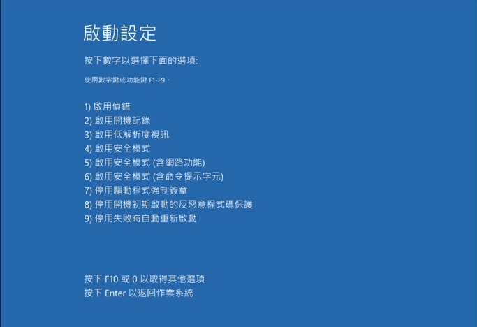
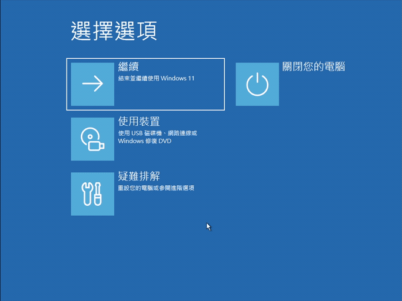
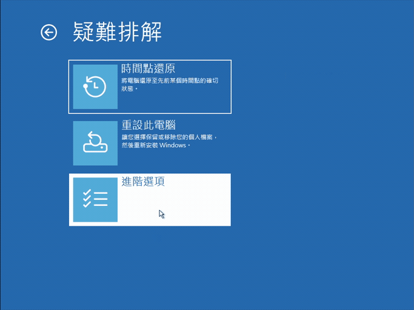
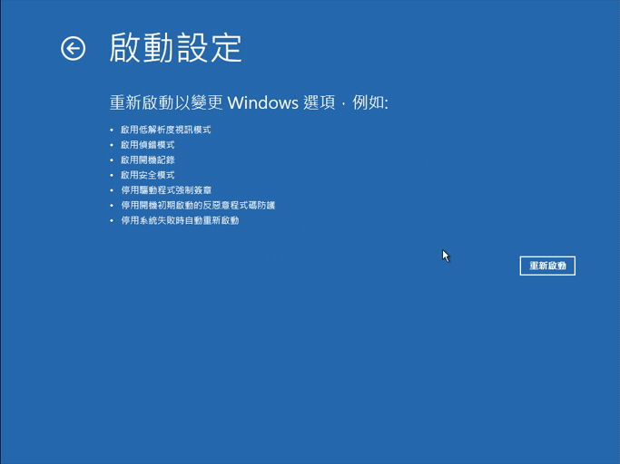
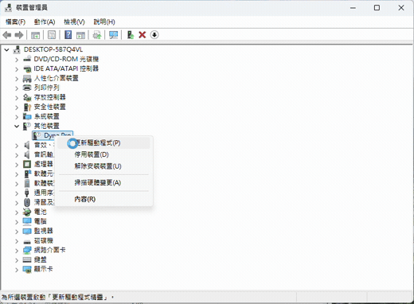
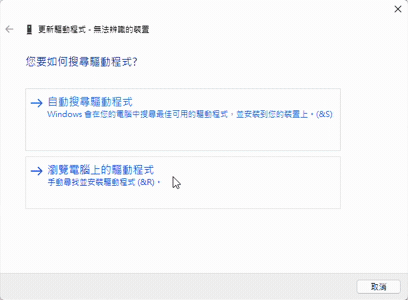
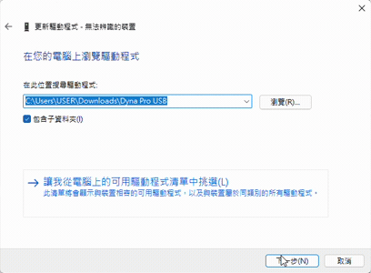
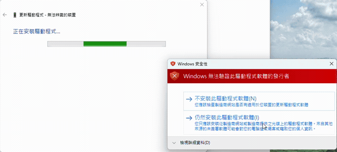
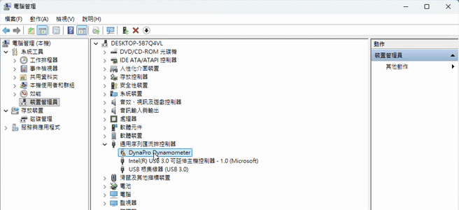
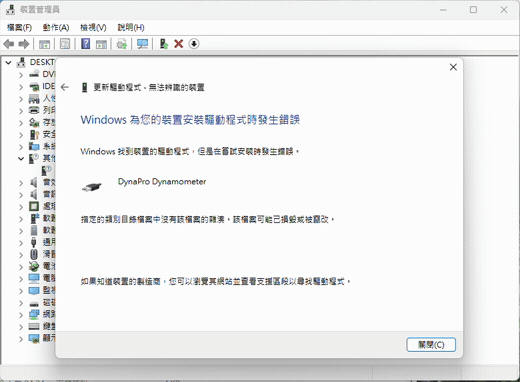

# Installing the Dyna Pro USB driver

[繁體中文在下方](#繁體中文)

Do this once on a PC that has never been connected to a Dyna Pro dynamometer. Without the driver, Windows lists the
device under *Other devices* and DynaRun cannot talk to it. DynaRunFix does not bundle the driver; it comes from
Dyna Pro. The user-facing summary is in the [README](../README.md#usage).

## Quick way: use the setup wizard

The DynaRunFix setup can do the steps below for you. Use it unless it tells you it cannot; the [manual method](#steps) stays
available.

* In the main installer, leave **Also install the Dyna Pro USB driver (one restart needed)** ticked (it is ticked by default and
  hidden if the driver is already installed or Windows is older than 10; Windows 8, 7, Vista and XP use the manual steps, see [older Windows](#older-windows)). Or, any time later, use the Start menu shortcut
  **Install Dyna Pro USB driver** (**安裝 Dyna Pro USB 驅動程式** on a Traditional Chinese Windows) or run `DynaRunFix-Setup.exe /driver`.
* The wizard first looks for a "Dyna Pro USB.zip" you already have (its own earlier download, the folder it runs from, Downloads and one folder
  below it, Desktop, Documents; any file name, so "Dyna Pro USB (1).zip" counts, and so does a folder where it was already unpacked, e.g. Downloads\Dyna Pro USB) and uses it without downloading when it holds the right driver
  files. Otherwise it downloads the official zip from dynapro.co.uk (it is not bundled). What is checked is the **content**: the 18 files Windows
  installs (the two INFs, their two catalogs, and the i386 and amd64 `.sys` / `.dll` files they name) must each have the SHA-256 built into the
  program; other files in the zip (readme, FT Clean, the duplicate "64-Bit Drivers" folder) are ignored, and only those 18 are unpacked. The
  copies that were unpacked and checked are the ones Windows installs.
* If the files differ (Dyna Pro may have updated the driver, or the file is damaged or was tampered with), the wizard shows a warning page with the
  source, the zip's SHA-256 and the files that differ. It offers **Install anyway** (not the default button) only when the package still looks like
  Dyna Pro's (all 18 files present, the bus INF names the Dyna Pro device id); otherwise the manual method below is the way. Choosing **Install anyway**
  applies to exactly that zip (or folder) for this one installation and is logged in `driver.log`; while it is in force the staging folder holds
  `accepted.txt` with the SHA-256 of exactly the files that were staged, and it is deleted when the driver step ends. If you cancel the warning for a
  copy found on this computer, later attempts (including resume and retry) download the driver from the Dyna Pro website instead; copies that differ are not offered again until the wizard is started again. Only copies the wizard found by itself are skipped this way: a file or folder you chose with **Choose file...** is always checked as it is, and the memory of the skipped copies does not apply to it.
* DynaRunFix does not check the digital signature of the driver files. It compares their SHA-256 values with the ones built into the program and, for **Install anyway**, checks that the bus INF names the Dyna Pro device ID. Whether to trust the source of a package that differs is your own decision.
* The download page (the same as for the DynaRun setup) has *Pause* / *Resume*, retries by itself (after 1, 2, 4, 8 and 15 seconds) and, if it still fails, shows
  the first error with **Continue download** (from the part that is already there), **Open website**, **Choose file...** (the zip, or ftdibus.inf in the folder where it is
  unpacked: the same check follows) and, in the main installer, **Skip**. If Windows says the computer has no network at all, that page comes at once.
* If DynaRun V3 and the fix are already installed and only the driver is missing, the installer's first page offers just the driver.
* Windows asks for administrator permission (UAC). On an administrator account that is once; a standard user may be asked for an
  administrator's password again after the restart. If BitLocker protection is on (or its status cannot be read), the wizard suspends it until the driver is installed
  (at most 3 restarts as a safety net, then it is resumed automatically; it is also resumed when the installation finishes or you cancel),
  sets the one-time advanced boot options and registers a task that continues the wizard when you sign in. While it is suspended, the
  drive is not protected; if you decide not to go on, cancel in the wizard (or run `/driver-cancel`, see below) so that it is resumed.
* BitLocker is suspended in one more case: the drive is still being encrypted or decrypted (also paused) and has a key protector (Windows reports
  that as "off", yet the restart menu would ask for the recovery key). The suspension is checked afterwards. If it failed, the wizard shows a
  warning page (Windows will probably ask for the recovery key; find it at https://aka.ms/myrecoverykey) and lets you choose **Restart anyway** or
  **Later**, which takes everything back; **Find the recovery key** opens that page. `driver.log` and `bitlocker-before.txt` next to it (the output of `manage-bde -status` and `-protectors
  -get`, recovery passwords masked before they are written) show what the wizard saw and did.
* Other wizard pages: *Check the installer* (before the license page of the main installer) has an **Open website** button. On Windows 8 and older
  (Windows 8 / 8.1, Vista / 7, XP) `/driver` shows **The driver was not installed** with the manual steps for that Windows and an
  **Open the manual steps** button (this document). If the driver is already installed, the wizard shows **The driver is already installed**.
* After the restart, press **7** in the start-up menu (*Disable driver signature enforcement*). The wizard shows the page below;
  photographing it with your phone first is a good idea. The picture marks the line *7) Disable driver signature enforcement* and says **Press 7**.

  | Press 7 |
  |---|
  |  |

* If you miss 7, the wizard says so after you sign in and offers **Retry**.
* Then Windows shows its red warning **twice** (once for each of the two driver files, ftdibus and ftdiport): choose
  **Install this driver software anyway** each time. Driver signature enforcement comes back at the next normal restart. The last wizard page offers
  **Start DynaRun**, which starts it as your normal user (not elevated).

Notes: the wizard needs Windows 10 or 11 (on older Windows use the [older Windows](#older-windows) steps below). The driver files go to `%ProgramData%\DynaRunFix\driver` and the log is
`%ProgramData%\DynaRunFix\driver.log`. The driver search and your choices are logged, with times, to `%TEMP%\DynaRunFix-setup.log`. Uninstalling DynaRunFix does not remove the driver (it does resume BitLocker if DynaRunFix suspended it and it is still suspended). Not yet verified on a real PC; the BitLocker path has not been tried on real hardware.
If the wizard says the working folder could not be prepared (an old folder is still in use, or it can be changed by other users), restart Windows and try again.

If something goes wrong: choosing **Cancel** on the wizard's retry or install page takes back the logon task, the boot option and
the BitLocker suspension. If you closed the wizard some other way and want those undone, the manual steps below do not depend on
it; you can also run `DynaRunFix-Setup.exe /driver-cancel` from an administrator command prompt (otherwise it exits with code 1 and does nothing; it only removes the task, the
one-time boot option and the BitLocker suspension, it does not install or remove a driver).

## What you need

* The driver zip from Dyna Pro's site:
  [Dyna Pro USB.zip](https://dynapro.co.uk/Site/graphics/Technical_Info/Software/Dyna%20Pro%20USB.zip)
* About 10 minutes and two restarts (one into the special start-up menu, one back to normal).

## Why the extra steps

The driver is FTDI's FTDIBUS/FTDIPORT driver (2.08.24, 2012) with the Dyna Pro device ID
`USB\VID_0403&PID_FDBC` ("DynaPro Dynamometer"). In the vendor's package, ftdibus.inf and ftdiport.inf are FTDI's INF with Dyna Pro device
names added, and they are not in the Microsoft-signed ftdibus.cat / ftdiport.cat that ship with them, so Windows cannot validate them and
refuses them: *"The hash for the file is not present in the specified catalog file"*. To install it,
driver signature enforcement has to be turned off for one start of Windows.

## Steps

### 1. Download and unzip

Download the zip above and unzip it (right-click, *Extract All...*), for example to
`C:\Users\<you>\Downloads\Dyna Pro USB`. Remember the folder; you pick it in step 4.

### 2. Only if the PC uses BitLocker or device encryption: suspend it until the driver is installed

The start-up menu in step 3 asks for the BitLocker recovery key on encrypted PCs. Avoid that by suspending BitLocker
first. Open **PowerShell as administrator** (right-click Start, *Terminal (Admin)*) and run:

```powershell
Suspend-BitLocker -MountPoint "C:" -RebootCount 3
```

Protection resumes by itself after at most 3 restarts; once the driver is installed you can resume it right away with `Resume-BitLocker -MountPoint "C:"`. If the recovery key is asked anyway, you can find it at
<https://aka.ms/myrecoverykey> (sign in with the Microsoft account the PC is linked to).

If you are not sure whether the PC is encrypted, you can check first (`Get-BitLockerVolume`, or *Manage BitLocker* in Control Panel). On an
encrypted PC the drive is **not protected** while it is suspended: until protection is resumed (`Resume-BitLocker -MountPoint "C:"`) or the 3 restarts
have run out, anyone who has the PC can read the drive. So if you suspended it and then do not go on with the driver, resume it yourself.

### 3. Restart with driver signature enforcement disabled

Open *Start*, click the power button, hold **Shift** and click **Restart**. Then:

1. *Choose an option* → **Troubleshoot**
2. **Advanced options** → **Startup Settings** → **Restart**
3. After the restart, press **7** (*Disable driver signature enforcement*).

| 1. Choose an option → Troubleshoot | 2. Advanced options | 3. Startup Settings → Restart |
|---|---|---|
|  |  |  |

| Press 7 |
|---|
|  |

This setting lasts only for that one start of Windows, which is enough: the install in step 4 needs it once.

These steps are for Windows 10 and 11, and Windows 8 / 8.1 is the same (Shift + Restart, then 7). For older Windows see [older Windows](#older-windows).

### 4. Plug in the Dyna Pro and point Windows at the driver folder

1. Connect the Dyna Pro by USB and switch it on.
2. Press **Win + X** and open **Device Manager**.
3. Under **Other devices**, right-click the Dyna Pro device and choose **Update driver**.
4. Choose **Browse my computer for drivers**.
5. Click *Browse...* and pick the unzipped **Dyna Pro USB** folder; make sure **Include subfolders** is ticked.
6. Click **Next**.

| Right-click, Update driver | Browse my computer for drivers | Folder, Include subfolders, Next |
|---|---|---|
|  |  |  |

### 5. "Windows can't verify the publisher"

A red *Windows Security* window appears, and it appears **twice** (once for each of the two driver files, ftdibus and ftdiport). Click **Install this driver software anyway** each time.

| Install this driver software anyway |
|---|
|  |

### 6. Done

When Windows reports that the driver was installed, the device is listed under **Universal Serial Bus controllers**
as **DynaPro Dynamometer**.

| The device in Device Manager |
|---|
|  |

*Windows 11 (Traditional Chinese). The device name under Other devices may differ on your PC.*

## Older Windows

The wizard needs Windows 10 or 11. On older Windows do the [steps](#steps) above, but replace step 3 (restart with driver signature
enforcement disabled) and the device-manager clicks of step 4 as below. These steps are from Microsoft's documented behaviour and have
not been tried by DynaRunFix on those systems.

* **Windows 8 / 8.1:** the same as step 3: hold **Shift**, click **Restart**, *Troubleshoot* > *Advanced options* > *Startup Settings* >
  *Restart*, then press **7** (*Disable driver signature enforcement*). 32-bit Windows 8 does not enforce driver signing and only shows the
  warning, so it can skip this. In Device Manager choose **Install this driver software anyway** on the red warning.
* **Windows Vista / 7:** restart and press **F8** repeatedly before the Windows logo appears. In *Advanced Boot Options* choose
  **Disable Driver Signature Enforcement**. After the restart open Device Manager, right-click the device, *Update Driver Software* >
  *Browse my computer for driver software* > *Let me pick* > **Have Disk...**, pick the `ftdibus.inf` in the unzipped folder, and click
  **Install this driver software anyway** on the red warning. 32-bit Vista / 7 do not enforce driver signing and only show the warning, so the F8 step can be
  skipped there.
* **Windows XP:** driver signatures are not enforced, so there is no restart step. In Device Manager, *Update Driver*, point it at the
  unzipped folder; when Windows says the software has not passed Windows Logo testing, click **Continue Anyway**.

## Troubleshooting

* **"The hash for the file is not present in the specified catalog file"** Step 3 was skipped, or Windows was restarted normally before step 4. Repeat step 3 and do step 4
  in that same session.

  | The error |
  |---|
  |  |

* **Startup Settings asks for a BitLocker recovery key.** Enter it (<https://aka.ms/myrecoverykey>), or restart
  normally, do step 2 and try again.
* **The drive stays unprotected.** If you suspended BitLocker (step 2, or the wizard did) and did not go on, resume it with
  `Resume-BitLocker -MountPoint "C:"` in an administrator PowerShell.
* **The device is not under *Other devices*.** Check the USB cable and that the Dyna Pro is switched on; unplug and
  plug it in again.

---

## 繁體中文

[English above](#installing-the-dyna-pro-usb-driver)

第一次把這台電腦接上 Dyna Pro 測功機時做一次。沒有驅動程式的話,Windows 會把裝置列在「其他裝置」,DynaRun 無法與它通訊。
DynaRunFix 不附驅動程式,驅動程式由 Dyna Pro 提供。使用者版說明見 [README](../README.md#使用方式)。

### 快速方式:使用安裝精靈

DynaRunFix 安裝程式可以幫你做完下面的步驟。除非它說做不到,建議直接用它;[手動方式](#步驟)仍然可用。

* 在主安裝程式中,保持勾選 **同時安裝 Dyna Pro USB 驅動程式（需重新開機一次）**(預設勾選;驅動程式已安裝或 Windows 低於 10 時會隱藏;Windows 8、7、Vista、XP 請用手動步驟,見[舊版 Windows](#舊版-windows))。
  之後隨時也可以用開始功能表捷徑 **安裝 Dyna Pro USB 驅動程式**,或執行 `DynaRunFix-Setup.exe /driver`。
* 精靈會先找你已經有的「Dyna Pro USB.zip」(它自己先前下載的、精靈所在資料夾、下載資料夾與其下一層、桌面、文件;檔名不限,所以「Dyna Pro USB (1).zip」也算,已經解開的資料夾例如 Downloads\Dyna Pro USB 也算),內容正確就直接使用、不用下載;找不到才從 dynapro.co.uk 下載官方的 zip(不內附)。檢查的是**內容**:Windows 會安裝的 18 個檔案(兩個 INF、它們的兩個 catalog,以及它們所指定的 i386 與 amd64 的 `.sys` / `.dll`)必須各自符合程式內建的 SHA-256;zip 裡的其他檔案(readme、FT Clean、重複的「64-Bit Drivers」資料夾)不看,也只解開這 18 個。Windows 安裝的就是解開並檢查過的那份。
* 如果檔案不同(可能是 Dyna Pro 更新了驅動程式,也可能是檔案損毀或被竄改),精靈會顯示警告頁,列出來源、zip 的 SHA-256 和不同的檔案。只有套件看起來仍是 Dyna Pro 的(18 個檔案都在、bus INF 含 Dyna Pro 的裝置 ID)才會提供「仍要安裝」(不是預設按鈕);否則請用下方的手動方式。選「仍要安裝」只對那一個 zip、這一次安裝有效,並記錄在 `driver.log`。「仍要安裝」生效期間,暫存資料夾裡有 `accepted.txt`(只含實際暫存的那些檔案的 SHA-256),驅動程式步驟結束時刪除。如果你對這台電腦上找到的檔案取消了警告頁,之後的嘗試(包括繼續與重試)都會改從 Dyna Pro 官網下載;在重新開啟精靈之前,不會再提供內容不同的檔案。只有精靈自己找到的副本會這樣被跳過:你用 **選擇檔案…** 選的檔案或資料夾一律照實檢查,不受這個記憶影響。
* DynaRunFix 不驗證驅動程式檔的數位簽章。它只比對檔案的 SHA-256 與程式內建的值,而在「仍要安裝」時檢查 bus INF 是否含 Dyna Pro 的裝置 ID。內容不同的套件來源可不可信,由你自己判斷。
* Windows 會要求系統管理員權限(UAC)。使用系統管理員帳戶時只會問一次;標準使用者在重新啟動後可能會再被要求輸入系統管理員密碼。若 BitLocker 保護為開啟(或無法讀取其狀態),精靈會暫停它直到驅動程式安裝完成(最多 3 次重新啟動作為保險,之後自動恢復;安裝完成或你按取消時也會恢復),設定一次性的進階開機選項,並登錄一個工作,在你登入後讓精靈繼續。暫停期間磁碟機沒有受到保護;如果你決定不繼續,請在精靈中按取消(或執行 `/driver-cancel`,見下方),讓保護恢復。
* 重新啟動後,在啟動選單按 **7**(停用驅動程式強制簽章)。精靈會顯示下面這個畫面,建議先用手機拍下來。圖上會標出「7) 停用驅動程式強制簽章」那一行並寫著 **按 7**。

  | 按 7 |
  |---|
  |  |

* 沒按到 7 的話,登入後精靈會告知,並提供 **重試**。
* 下載頁(和 DynaRun 安裝檔的一樣)有「暫停」/「繼續」,中斷時會自動重試(依序等 1、2、4、8、15 秒);仍然失敗就顯示第一個錯誤,提供 **繼續下載**(從已經下載的部分接續)、**開啟官網**、**選擇檔案…**(zip,或已解開它的資料夾裡的 ftdibus.inf:接著做同樣的檢查),主安裝程式裡還有 **略過**。Windows 說電腦完全沒有網路時,那一頁會立刻出現。
* 已安裝 DynaRun V3 與修正、只缺驅動程式時,安裝程式第一頁只提供驅動程式。
* BitLocker 還有一種情況也會暫停:磁碟機仍在加密或解密中(含暫停)且有金鑰保護裝置(Windows 會報成「關閉」,但重新開機選單仍會要求修復金鑰)。暫停之後會檢查;失敗時精靈會顯示警告頁(Windows 很可能會要求修復金鑰;可到 https://aka.ms/myrecoverykey 查詢),讓你選 **仍要重新開機** 或 **稍後**(會撤回所有已設定的項目);**查詢修復金鑰** 會開啟那個頁面。`driver.log` 與旁邊的 `bitlocker-before.txt`(`manage-bde -status` 和 `-protectors -get` 的輸出,修復密碼寫入前先遮蔽)記錄精靈看到與做了什麼。
* 其他精靈頁面:「確認安裝檔」頁(在主安裝程式的授權合約頁之前)有 **開啟官網** 按鈕。在 Windows 8 與更舊的版本(Windows 8 / 8.1、Vista / 7、XP)上,`/driver` 會顯示 **驅動程式沒有安裝**,附上該版 Windows 的手動步驟與 **開啟手動安裝說明** 按鈕(就是這份文件)。驅動程式已經安裝時,精靈會顯示 **驅動程式已安裝**。
* 接著 Windows 會跳出紅色警告,而且會出現兩次(兩個驅動程式檔 ftdibus 與 ftdiport 各一次),每次都請選 **仍然安裝此驅動程式軟體**。驅動程式強制簽章在下次正常重新啟動後恢復。精靈最後一頁提供「開始使用 DynaRun」,以你的一般使用者身分啟動(不是提升權限)。

附註:精靈需要 Windows 10 或 11(舊版 Windows 請看下面的[舊版 Windows](#舊版-windows))。驅動程式檔案放在 `%ProgramData%\DynaRunFix\driver`,記錄檔是 `%ProgramData%\DynaRunFix\driver.log`。驅動程式搜尋與你的選擇會帶著時間記錄在 `%TEMP%\DynaRunFix-setup.log`。
解除安裝 DynaRunFix 不會移除驅動程式(但如果 BitLocker 是 DynaRunFix 暫停的、且仍在暫停,會把它恢復)。尚未在實體電腦上驗證;BitLocker 的路徑也還沒有在實體硬體上試過。
如果精靈說工作資料夾無法準備好(舊資料夾仍在使用中,或其他使用者可以更改它),請重新啟動 Windows 再試一次。

如果出了問題:在精靈的重試或安裝頁面按 **取消**,會撤回登入工作、開機選項與 BitLocker 暫停。若是用其他方式關掉精靈、想把這些還原,
可以在以系統管理員身分開啟的命令提示字元執行 `DynaRunFix-Setup.exe /driver-cancel`(否則它以結束代碼 1 結束、什麼都不做;只移除工作、一次性開機選項與 BitLocker 暫停,不會安裝或移除驅動程式)。
下面的手動步驟不依賴精靈。

### 需要準備

* Dyna Pro 官網的驅動程式 zip:
  [Dyna Pro USB.zip](https://dynapro.co.uk/Site/graphics/Technical_Info/Software/Dyna%20Pro%20USB.zip)
* 約 10 分鐘與兩次重新啟動(一次進特殊啟動選單,一次回到正常模式)。

### 為什麼要多這幾步

這是 FTDI 的 FTDIBUS/FTDIPORT 驅動程式(2.08.24,2012 年),加有 Dyna Pro 的裝置 ID
`USB\VID_0403&PID_FDBC`(「DynaPro Dynamometer」)。廠商封裝中的 ftdibus.inf、ftdiport.inf 是加上 Dyna Pro 裝置名稱的 FTDI INF,
且不在隨附的 Microsoft 簽署目錄檔(ftdibus.cat/ftdiport.cat)中,因此 Windows 無法驗證,會拒絕:「指定的類別目錄檔案中沒有該檔案的雜湊」。
要安裝就得在 Windows 啟動一次的期間停用驅動程式強制簽章。

### 步驟

#### 1. 下載並解壓縮

下載上面的 zip 並解壓縮(右鍵 →「全部解壓縮…」),例如解壓到 `C:\Users\<你>\Downloads\Dyna Pro USB`。
記住這個資料夾,步驟 4 要選它。

#### 2. 只有電腦使用 BitLocker 或裝置加密時:先暫停到驅動程式安裝完成

加密的電腦在步驟 3 的啟動選單會要求輸入 BitLocker 復原金鑰。先暫停 BitLocker 就能避免。
以**系統管理員身分開啟 PowerShell**(對開始按鈕按右鍵 →「終端機 (系統管理員)」),執行:

```powershell
Suspend-BitLocker -MountPoint "C:" -RebootCount 3
```

最多 3 次重新啟動之後保護會自動恢復;驅動程式安裝完成後也可以用 `Resume-BitLocker -MountPoint "C:"` 立刻恢復。如果還是被要求輸入復原金鑰,可以到 <https://aka.ms/myrecoverykey> 查詢(登入與這台電腦綁定的 Microsoft 帳號)。

不確定有沒有加密的話,可以先確認(`Get-BitLockerVolume`,或控制台的「管理 BitLocker」)。加密的電腦在暫停期間磁碟機**沒有受到保護**:在你用 `Resume-BitLocker -MountPoint "C:"` 恢復保護、或 3 次重新啟動用完之前,拿到這台電腦的人都能讀取磁碟機。所以如果你暫停了它、之後不繼續安裝驅動程式,請自己把它恢復。

#### 3. 停用驅動程式強制簽章後重新啟動

按「開始」→ 電源按鈕,按住 **Shift** 再按 **重新啟動**。然後:

1. 「選擇選項」→ **疑難排解**
2. **進階選項** → **啟動設定** → **重新啟動**
3. 重新啟動後按 **7**(停用驅動程式強制簽章)。

| 1. 選擇選項 → 疑難排解 | 2. 進階選項 | 3. 啟動設定 → 重新啟動 |
|---|---|---|
|  |  |  |

| 按 7 |
|---|
|  |

這個設定只在這一次的 Windows 啟動期間有效,這樣就夠了:步驟 4 的安裝只需要它一次。

這些步驟適用 Windows 10 與 11,Windows 8 / 8.1 相同(Shift + 重新啟動,再按 7)。更舊的 Windows 請看[舊版 Windows](#舊版-windows)。

#### 4. 接上 Dyna Pro,指定驅動程式資料夾

1. 用 USB 接上 Dyna Pro 並開機。
2. 按 **Win + X**,開啟 **裝置管理員**。
3. 在 **其他裝置** 底下對 Dyna Pro 裝置按右鍵,選 **更新驅動程式**。
4. 選 **瀏覽電腦上的驅動程式**。
5. 按「瀏覽…」選剛解壓縮的 **Dyna Pro USB** 資料夾,確認已勾選 **包括子資料夾**。
6. 按 **下一步**。

| 按右鍵 → 更新驅動程式 | 瀏覽電腦上的驅動程式 | 資料夾、包括子資料夾、下一步 |
|---|---|---|
|  |  |  |

#### 5. 「Windows 無法驗證此驅動程式軟體的發行者」

會出現紅色的「Windows 安全性」視窗,而且會出現兩次(兩個驅動程式檔 ftdibus 與 ftdiport 各一次),每次都按 **仍然安裝此驅動程式軟體**。

| 仍然安裝此驅動程式軟體 |
|---|
|  |

#### 6. 完成

Windows 顯示驅動程式安裝完成後,裝置會列在 **通用序列匯流排控制器** 底下,名稱為 **DynaPro Dynamometer**。

| 裝置管理員裡的裝置 |
|---|
|  |

*Windows 11(繁體中文)。你的電腦上「其他裝置」底下的裝置名稱可能不同。*

### 舊版 Windows

精靈需要 Windows 10 或 11。舊版 Windows 請照上面的[步驟](#步驟)做,但步驟 3(以停用驅動程式強制簽章的方式重新啟動)與步驟 4 的裝置管理員操作請改為如下。
這些步驟依據 Microsoft 文件記載的行為,DynaRunFix 尚未在這些系統上試過。

* **Windows 8 / 8.1:** 與步驟 3 相同:按住 **Shift** 再按 **重新啟動**,*疑難排解* > *進階選項* > *啟動設定* > *重新啟動*,然後按 **7**(*停用驅動程式強制簽章*)。32 位元的 Windows 8 不強制驅動程式簽章、只會顯示警告,可以略過這一步。在裝置管理員,紅色警告出現時選 **仍然安裝此驅動程式軟體**。
* **Windows Vista / 7:** 重新開機,在出現 Windows 標誌之前連續按 **F8**,在「進階開機選項」選 **停用驅動程式強制簽章**。重新啟動後開啟裝置管理員,
  對裝置按右鍵,*更新驅動程式軟體* > *瀏覽電腦上的驅動程式軟體* > *讓我從清單選擇* > **從磁片安裝...**,選解壓縮資料夾裡的 `ftdibus.inf`,
  紅色警告出現時選 **仍然安裝此驅動程式軟體**。32 位元的 Vista / 7 不強制驅動程式簽章、只會顯示警告,可以略過 F8 這一步。
* **Windows XP:** 不強制驅動程式簽章,沒有重新啟動的步驟。在裝置管理員選 *更新驅動程式*,指向解壓縮的資料夾;Windows 說軟體未通過 Windows 標誌測試時,按 **仍然繼續**。

### 疑難排解

* **「指定的類別目錄檔案中沒有該檔案的雜湊…」** 表示跳過了步驟 3,
  或是在步驟 4 之前已經正常重新啟動過。重做步驟 3,並在同一次啟動內做步驟 4。

  | 錯誤畫面 |
  |---|
  |  |

* **啟動設定要求輸入 BitLocker 復原金鑰。** 輸入金鑰(<https://aka.ms/myrecoverykey>),或正常重新啟動、做完步驟 2 再試一次。
* **磁碟機一直沒有受到保護。** 如果你(或精靈)暫停了 BitLocker 卻沒有繼續安裝,請以系統管理員身分開啟 PowerShell,執行 `Resume-BitLocker -MountPoint "C:"` 恢復。
* **「其他裝置」底下沒有裝置。** 檢查 USB 線與 Dyna Pro 是否已開機,拔掉再插一次。
